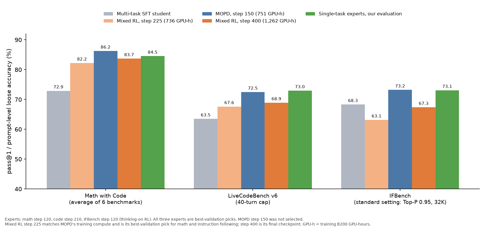
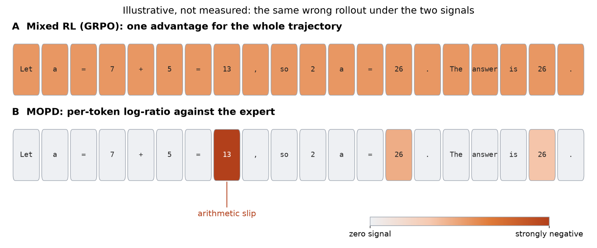
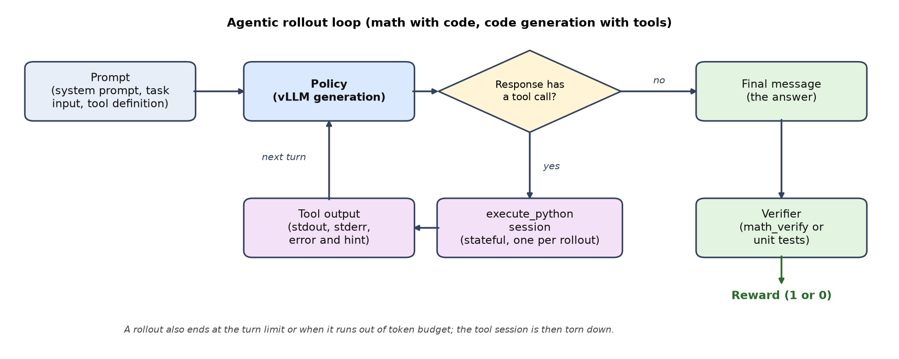
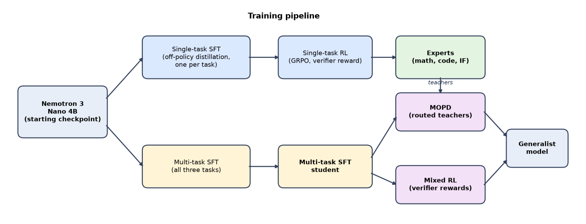
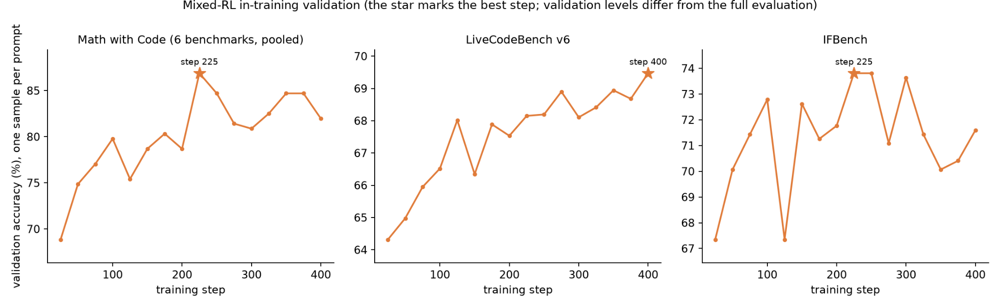
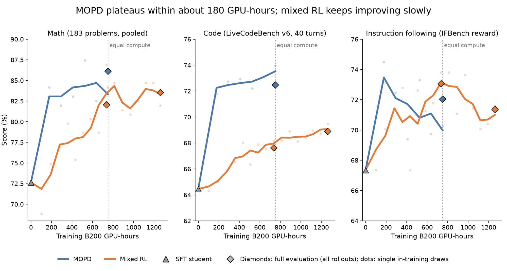
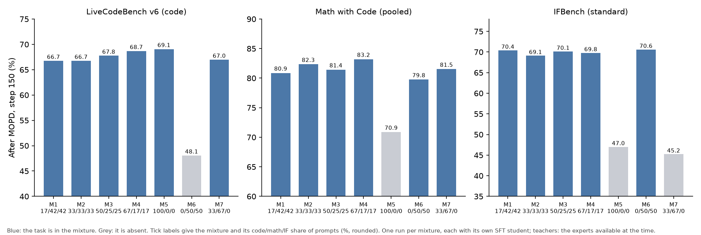

  

# Mixed RL vs. Multi-Teacher On-Policy Distillation for Multi-Task Post-Training with NVIDIA NeMo on Gemini Enterprise Agent Platform

**Authors:** [Dustin Luong](mailto:dustinluong@google.com), [Xuehan Xiong](mailto:xxman@google.com)

## Table of Contents

* [Intro](#intro)
* [Background](#background)
    * [A Unified Objective](#a-unified-objective)
    * [Mixed RL](#mixed-rl)
    * [Multi-Teacher On-Policy Distillation (MOPD)](#multi-teacher-on-policy-distillation-mopd)
    * [Comparing the Two Objectives](#comparing-the-two-objectives)
* [Experimental Setup](#experimental-setup)
* [Results](#results)
    * [Head to Head at Equal Compute](#head-to-head-at-equal-compute)
    * [Why MOPD Matches Its Experts](#why-mopd-matches-its-experts)
    * [Which Tasks Belong in the Data](#which-tasks-belong-in-the-data)
* [Key Takeaways](#key-takeaways)
* [Acknowledgements](#acknowledgements)

## Intro

One production model often has to serve several tasks. Training one specialist per task is the easy option, but every specialist has to be hosted, served and routed to, so a single model that matches the specialists is cheaper to operate.

Starting from the same checkpoint, a multi-task student (trained with supervised fine-tuning, SFT, on all the tasks together) falls short of the best single-task expert on each task. A further training stage has to close that gap, and two approaches are standard:

1. **Mixed RL** runs one reinforcement learning job over a mixture of task environments. Each prompt is scored by its own task’s verifier, and one policy is updated on the combined batch.
2. **Multi-Teacher On-Policy Distillation (MOPD)** first trains one expert per task, then distills all of them into one student. The student generates its own responses, and the matching task’s expert scores every generated token.

Both appear in recent open models. [DeepSeek-V3.2](https://arxiv.org/abs/2512.02556) fine-tunes on data distilled from domain specialists, then runs one mixed RL stage over reasoning, agent and human-alignment tasks. [NVIDIA Nemotron 3 Nano](https://arxiv.org/abs/2512.20848) runs RL on all of its environments at once. [DeepSeek-V4](https://arxiv.org/abs/2606.19348) (§5.1.2), [MiMo-V2-Flash](https://arxiv.org/abs/2601.02780) and [NVIDIA Nemotron 3 Ultra](https://arxiv.org/abs/2606.15007) use MOPD instead. Neither is the obvious choice. Mixed RL trains one policy on tasks that differ in reward sparsity, response length and learning speed, so a gain on one task can cost another. MOPD gives each task a dense signal from its own specialist, but it needs one expert per task, all served during distillation.

We compare mixed RL and MOPD on [NVIDIA Nemotron 3 Nano 4B](https://huggingface.co/nvidia/NVIDIA-Nemotron-3-Nano-4B-BF16) across three tasks: competition math with a Python interpreter, competitive programming where the model tests and debugs its own code (both **agentic**), and instruction following (**non-agentic**). Both methods start from the same multi-task student and share prompts, harness (the tool-use loop around the model), turn cap (the most tool calls per rollout) and sampling parameters.

Math and code are scored by pass@1, the chance that one sample solves a problem: math averaged over six AIME and HMMT benchmarks, code on LiveCodeBench v6. Instruction following is scored on IFBench, a held-out set of verifiable output constraints, by prompt-level loose accuracy: the share of prompts whose response meets every constraint after lenient normalization.

Our main results are:

1. **At equal training compute, MOPD is ahead of mixed RL on math and code; on instruction following it is ahead at one decoding setting and level at the other.** At about 750 NVIDIA B200 GPU-hours (GPUs times hours), MOPD leads mixed RL by 4.0 points on math and 4.9 on code (Table 3). Its validation curve is flat after about 25 steps, while mixed RL is still improving on code at step 400 (both methods use 64 prompts × 8 rollouts per step). On instruction following, mixed RL is much worse at the model card’s Top-P 0.95 (the nucleus-sampling cutoff) and level with MOPD at Top-P 1.0, the value it trained with. Figure 1 uses the model card’s setting; Table 3 gives both.
2. **MOPD matches its experts, but it needs the experts first.** MOPD ends level with all three single-task experts (Table 3): 1.7 points above the math expert, 0.5 below the code expert and up to 1.1 below the instruction-following expert, with both shortfalls within noise. Its steps cost more than mixed-RL steps because 24 of its 64 NVIDIA GPUs serve the experts, but it converges in far fewer steps. The experts are a one-time cost of about 4,700 NVIDIA H100 and 500 NVIDIA B200 GPU-hours (Table 4).
3. **A domain left out of both SFT and the mixture never recovers.** Such a domain ended 9 to 25 points below mixtures that include it, while the share of an included domain mattered less than we could measure.

This is the sixth installment of our blog series on model training best practices for customers of [Gemini Enterprise Agent Platform training clusters](https://docs.cloud.google.com/gemini-enterprise-agent-platform/machine-learning/training/training-clusters/overview) (formerly Vertex AI Training Cluster).

<figure align="center" id="fig-teaser">
<table align="center" width="80%">
  <tr>
    <td align="center" width="100%">
       
    </td>
  </tr>
</table>
<figcaption align="left">
<b>Figure 1: Mixed RL vs. MOPD.</b> <i>pass@1 (math, code) and prompt-level loose accuracy (IFBench at Top-P 0.95) for the multi-task SFT student, the mixed-RL run at two checkpoints, MOPD and the single-task experts; code with at most 40 tool-call turns. Training GPU-hours are in Table 3.</i>
</figcaption>
</figure>

## Background

Mixed RL and MOPD look like different algorithms: one maximizes a reward, the other imitates a set of experts. Both can be written as the same token-level policy-gradient update on the student’s own rollouts, and in this form they differ mainly in how they compute the **advantage**, the per-token signal that says whether a generated token should become more or less likely. We first write down the shared objective, then show how each method fills in the advantage.

Take one math rollout in which the student makes a single arithmetic slip and the final answer comes out wrong. Mixed RL gives the whole trajectory a reward of 0. When other rollouts of the same prompt succeed, every token of this one gets the same negative advantage, correct steps included. In MOPD, the expert scores each token separately. It gives a low log-ratio (the expert finds the token much less likely than the student does) mainly to the tokens that carry the slip and the tokens that depend on it. The credit lands where the mistake is (Figure 2).

<figure align="center" id="fig-slip-example">
<table align="center" width="80%">
  <tr>
    <td align="center" width="100%">
       
    </td>
  </tr>
</table>
<figcaption align="left">
<b>Figure 2: The slip example, illustrated.</b> <i>Illustrative, not measured. The same wrong rollout under the two signals: mixed RL gives every token the same negative advantage (A), while MOPD’s per-token log-ratio is near zero except at the slip and the tokens that depend on it (B).</i>
</figcaption>
</figure>

### A Unified Objective

We have $K$ tasks, and task $k$ has its own prompt distribution $\mathcal{D} _ k$. Training prompts are drawn from a mixture $\mathcal{D} = \sum _ k \lambda _ k \mathcal{D} _ k$, and $k(x)$ denotes the task that prompt $x$ belongs to. For each prompt, the student policy $\pi _ \theta$ generates a group of $G$ rollouts $y _ 1, \dots, y _ G$. In the agentic tasks, a rollout interleaves model-generated tokens with tool outputs. Throughout this section, we use two indices:

* $i$ indexes **rollouts** in a training batch. Each rollout belongs to exactly one prompt’s group, so a batch of $P$ prompts contains $P \times G$ rollouts.
* $t$ indexes **token positions** within rollout $i$, so $y _ {i,t}$ is the $t$-th token of rollout $i$.

We write $s _ {i,t}$ for the context before token $y _ {i,t}$ (the prompt plus everything generated or returned so far), and $m _ {i,t} \in \lbrace 0, 1 \rbrace$ for a mask that is 1 only on tokens the model generated. Tool outputs are part of the context, but they are never trained on.

Three versions of the policy appear in the update:

* $\pi _ {\text{gen}}$: the inference engine (vLLM) that sampled the rollouts.
* $\pi _ {\text{old}}$: the same weights evaluated by the training engine (Megatron) when the batch is prepared. In theory $\pi _ {\text{old}} = \pi _ {\text{gen}}$, but differences in kernels and numerics make them diverge slightly.
* $\pi _ \theta$: the policy being optimized.

Both methods minimize a token-level surrogate loss of the same form:

$$\mathcal{L}(\theta) = -\frac{1}{N_{\text{tok}}} \sum_{i} \sum_{t} m_{i,t}\, w_{i,t}\, \ell\big(\theta;\, \hat{A}_{i,t}\big), \qquad w_{i,t} = \mathrm{sg}\!\left[\frac{\pi_{\text{old}}(y_{i,t} \mid s_{i,t})}{\pi_{\text{gen}}(y_{i,t} \mid s_{i,t})}\right]$$

where $N _ {\text{tok}}$ is the number of trained tokens in the batch, and $\mathrm{sg}[\cdot]$ stops gradients.

* $w _ {i,t}$ is an **importance-sampling correction** for the mismatch between the inference engine and the training engine.
* $\ell$ is the per-token policy-gradient term: for MOPD it is $\hat{A}\,\log \pi _ \theta(y _ {i,t} \mid s _ {i,t})$, and for mixed RL it is the clipped PPO surrogate $\min\big(r _ {i,t}\hat{A},\ \mathrm{clip}(r _ {i,t}, \text{lower}, \text{upper})\,\hat{A}\big)$ with ratio $r _ {i,t} = \pi _ \theta(y _ {i,t} \mid s _ {i,t}) / \pi _ {\text{old}}(y _ {i,t} \mid s _ {i,t})$ (both written out below).
* $\hat{A} _ {i,t}$ is the **advantage**.

At $\theta = \theta _ {\text{old}}$ the ratio is 1, so $\nabla _ \theta \ell = \hat{A}\,\nabla _ \theta \log \pi _ \theta$ for both forms of $\ell$, and the gradient of both losses reduces to the familiar policy gradient:

$$\nabla_\theta \mathcal{L} = -\frac{1}{N_{\text{tok}}} \sum_{i,t} m_{i,t}\, w_{i,t}\, \hat{A}_{i,t}\, \nabla_\theta \log \pi_\theta(y_{i,t} \mid s_{i,t})$$

So a positive advantage pushes the token’s probability up, and a negative advantage pushes it down. The two methods differ mainly in where $\hat{A} _ {i,t}$ comes from.

### Mixed RL

Mixed RL maximizes the expected verifier reward over the task mixture:

$$\max_\theta\; \mathbb{E}_{x \sim \mathcal{D}}\; \mathbb{E}_{y \sim \pi_\theta(\cdot \mid x)} \big[ R_{k(x)}(x, y) \big]$$

where $R _ k$ is task $k$’s verifier: answer equivalence for math, hidden unit tests for code, and constraint checks for instruction following. Each prompt is scored by its own task’s verifier. Beyond that, the update has no notion of tasks.

**Advantage.** We use the group-relative advantage of GRPO (group relative policy optimization) with a leave-one-out baseline. For rollout $i$ with reward $R _ i$, the baseline and scale come from the *other* $G-1$ rollouts of the same prompt. Writing $\mathcal{G}(i)$ for the group that rollout $i$ belongs to:

$$\hat{A}_{i,t} = \frac{R_i - b_i}{\sigma_i + \epsilon}, \qquad b_i = \frac{1}{G-1}\sum_{j \in \mathcal{G}(i),\, j \neq i} R_j, \qquad \sigma_i = \mathrm{std}\big(\lbrace R_j \rbrace_{j \in \mathcal{G}(i),\, j \neq i}\big)$$

The same value is broadcast to every generated token of the rollout. Groups in which all rollouts receive the same reward have zero advantage and contribute no gradient. Because normalization happens within each prompt’s group, the advantages of different tasks end up on a comparable scale, even when their reward distributions differ. We clip the result to ±5, because the leave-one-out standard deviation can be tiny.

**Policy term.** Each step’s rollouts are split into several mini-batches, so $\pi _ \theta$ drifts from $\pi _ {\text{old}}$ within a step. We therefore use the clipped surrogate of PPO (proximal policy optimization) with an asymmetric clip range and [dual clipping](https://arxiv.org/abs/1912.09729):

$$\ell = \min\!\Big(r_{i,t}\hat{A}_{i,t},\; \mathrm{clip}\big(r_{i,t},\, 1-\epsilon_{\text{low}},\, 1+\epsilon_{\text{high}}\big)\hat{A}_{i,t}\Big), \qquad r_{i,t} = \frac{\pi_\theta(y_{i,t} \mid s_{i,t})}{\pi_{\text{old}}(y_{i,t} \mid s_{i,t})}$$

For negative advantages, dual clipping also bounds the term at $c\,\hat{A} _ {i,t}$. We use $c = 10$ and no KL penalty against a reference policy.

### Multi-Teacher On-Policy Distillation (MOPD)

MOPD starts from $K$ experts $\pi _ {T _ 1}, \dots, \pi _ {T _ K}$, one per task (the subscript T marks their role as teachers in the distillation objective), and trains the student to match the expert of each prompt’s task *on the student’s own samples*. As in our [first blog](https://googlecloudplatform.github.io/vertex-ai-samples/vertex-training-cluster/model_distillation_best_practices#background), this is a **reverse KL** objective (it penalizes the student for putting probability on tokens the expert finds unlikely):

$$\min_\theta\; \mathbb{E}_{x \sim \mathcal{D}} \Big[ \mathrm{KL}\big( \pi_\theta(\cdot \mid x) \,\big\|\, \pi_{T_{k(x)}}(\cdot \mid x) \big) \Big]$$

Expanding the sequence-level KL into per-token terms gives

$$\mathrm{KL}\big(\pi_\theta \,\|\, \pi_T\big) = \mathbb{E}_{y \sim \pi_\theta} \Big[ \sum_t \big( \log \pi_\theta(y_t \mid s_t) - \log \pi_T(y_t \mid s_t) \big) \Big]$$

Crediting each token only with its own term (an approximation) turns this KL into the unified update, where the **per-token reward** is the expert-student log-ratio.

**Advantage.** For each prompt, the expert of its task scores every token the student generated, and the advantage is

$$\hat{A}_{i,t} = \mathrm{clip}\Big( \mathrm{sg}\big[ \log \pi_{T_{k(x)}}(y_{i,t} \mid s_{i,t}) - \log \pi_{\text{old}}(y_{i,t} \mid s_{i,t}) \big],\; -\delta,\; \delta \Big)$$

A token the expert likes more than the student gets a positive advantage, and a token the expert finds unlikely gets a negative one. Four properties distinguish this from the mixed RL advantage:

* **Dense:** every token gets its own signal, instead of one scalar per trajectory.
* **No verifier needed during training:** the verifier rewards are still computed for monitoring, but they don’t enter the update.
* **No baseline and no normalization:** the signal is already zero where the expert agrees with the student.
* **Clip at ±2:** the log-ratio is unbounded below (it becomes very negative when the expert strongly rejects a token), so we clip it to $[-\delta, \delta]$ with $\delta = 2$.

The experts and the student must share the same tokenizer, so that an expert can score the student’s tokens one-to-one.

**Policy term.** MOPD uses the plain REINFORCE form, with no ratio and no clipping:

$$\ell = \hat{A}_{i,t}\, \log \pi_\theta(y_{i,t} \mid s_{i,t})$$

MOPD also sets the importance weight $w _ {i,t} = 0$ for any token whose training-to-inference probability ratio $\pi _ {\text{old}}/\pi _ {\text{gen}}$ falls outside $[0.2, 5]$ (ICE-POP, a truncation of tokens with an extreme ratio). Both methods drop a rollout whose token probabilities differ between the two engines by more than a factor of 2 on average (mean over its tokens of $\exp \vert \log\pi _ {\text{gen}} - \log\pi _ {\text{old}} \vert > 2$).

### Comparing the Two Objectives

Table 1 puts the two methods side by side. The defining difference is the advantage: a sparse, verifier-derived scalar shared by every token in mixed RL, versus a dense, expert-derived signal for each token in MOPD. The other rows also differ between the two recipes we ran, and we did not ablate them one at a time.

|  | Mixed RL (GRPO) | MOPD |
| --- | --- | --- |
| Advantage $\hat{A} _ {i,t}$ | $(R _ i - b _ i)/(\sigma _ i + \epsilon)$, same for all tokens | $\log \pi _ {T _ {k(x)}} - \log \pi _ {\text{old}}$, per token |
| Source of supervision | Task verifier | Task expert |
| Signal density | One scalar per trajectory | One value per token |
| Baseline / normalization | Leave-one-out mean and std within the group; clipped to $[-5, 5]$ in our runs | None; clipped to $[-2, 2]$ |
| Policy term $\ell$ | PPO clipped surrogate (asymmetric clip, dual clip) | REINFORCE |
| Importance-sampling correction | $\pi _ {\text{old}}/\pi _ {\text{gen}}$, plus a sequence-level filter (sequences whose mean per-token probability-ratio error, $\exp \vert \Delta \log p \vert$, exceeds 2 are masked) | $\pi _ {\text{old}}/\pi _ {\text{gen}}$ with ICE-POP truncation $[0.2, 5]$, plus the same sequence-level filter |
| Models in the training loop | Student | Student + $K$ experts |

**Table 1:** Mixed RL and MOPD as two instances of the same policy-gradient update. The mixed-RL entries describe our run.

## Experimental Setup

**Tasks.** The student is trained on three tasks, and each has a programmatic verifier that turns a finished response into a reward.

* **Math with Code (agentic).** The model solves competition problems (AIME, HMMT, olympiad style) with a Python interpreter as a scratchpad for exact arithmetic, enumeration and numerical checks, and reports a final `\boxed{...}` answer. The reward is 1 if the answer is mathematically equivalent to the ground truth ([`math_verify`](https://github.com/huggingface/Math-Verify)) and 0 otherwise.
* **Code Generation with Tools (agentic).** The model solves competitive-programming problems and can run its candidate solution on sample cases and on edge cases it writes itself, read the errors and fix the code before submitting. The reward is 1 only if the final solution passes all hidden unit tests; the model’s own tests do not count.
* **Instruction Following (IF, non-agentic).** An ordinary user request has one to five verifiable constraints appended (for example, “write exactly 6 paragraphs separated by `***`”), and the model answers in one response with no tool. The reward is the fraction of constraints met, and 0 for a rollout that never reaches a final answer. We include it because it is easy to lose: a student fine-tuned on math and code alone scored about 15.6 points below the public Nano 4B checkpoint on IFBench at the model card’s Top-P 0.95 (41.0 against 56.6).

**Harness.** The two agentic tasks share one harness (Figure 3) for training and evaluation. The model generates, tool calls run in a per-rollout, stateful `execute_python` interpreter, and a rollout ends at a final message without a tool call, at the turn limit or at the token budget. The verifier reads only the final message. Both tasks use a 40-turn cap. They differ in the final-answer format (the last `\boxed{...}` for math, a single Python code block for code) and in the verifier (answer equivalence, or hidden unit tests run by the LiveCodeBench grader).

<figure align="center" id="fig-rollout-loop">
<table align="center" width="80%">
  <tr>
    <td align="center" width="100%">
       
    </td>
  </tr>
</table>
<figcaption align="left">
<b>Figure 3: The agentic rollout loop.</b> <i>The policy generates; a tool call is run in the rollout's own interpreter and its output appended; a response without a tool call is the final message that the verifier scores.</i>
</figcaption>
</figure>

**Training data.** All prompts come from public datasets and are filtered to those a program can verify. MOPD and mixed RL share one set of 54,060 prompts, 18,020 per domain, each drawn from its domain’s SFT corpus. Ten of the 294 IFBench prompts reuse a base prompt, with different constraints, from the IF expert’s single-task RL pool, so MOPD could meet them indirectly through that expert. No IFBench prompt appears in the SFT, MOPD or mixed-RL prompts. Re-scoring every model without those ten moves no score by more than 0.65 points and changes no ranking.

**Experts and student.** Every model starts from the public post-trained NVIDIA Nemotron 3 Nano 4B checkpoint, which we call the starting checkpoint. Each expert is trained in two stages: single-task SFT on traces from a larger teacher ([GLM-4.7](https://huggingface.co/zai-org/GLM-4.7-FP8) for the agentic tasks, [Nemotron 3 Ultra 550B](https://huggingface.co/nvidia/NVIDIA-Nemotron-3-Ultra-550B-A55B-NVFP4) for instruction following), which is off-policy distillation, then single-task RL. A **multi-task SFT student**, fine-tuned on all three tasks’ traces, is the common starting point of MOPD and mixed RL, so the two methods compare like for like (Figure 4). MOPD later distills the experts into this student.

**Expert results.** On math, single-task SFT lifts the starting checkpoint from 53.9 to 72.7 and RL adds 11.8 (to 84.5); on code the two stages add about equally (54.1 to 64.2, then 73.0). On instruction following, SFT raises the share of rollouts that never reach a final message, and so score zero, from 0.7% to 4.5%; RL brings it back to 2.1%. Table 3 lists the expert scores MOPD has to match.

<figure align="center" id="fig-pipeline">
<table align="center" width="80%">
  <tr>
    <td align="center" width="100%">
       
    </td>
  </tr>
</table>
<figcaption align="left">
<b>Figure 4: The training pipeline.</b> <i>The starting checkpoint is fine-tuned once per task to produce experts (top) or once on all three tasks to produce the multi-task student (bottom); MOPD distills the experts into that student, and mixed RL trains it directly on the verifiers.</i>
</figcaption>
</figure>

**Training framework.** We train with [NVIDIA NeMo RL](https://github.com/NVIDIA-NeMo/RL) (Megatron backend, vLLM generation). Each task is an environment in NVIDIA NeMo Gym, an open library for agentic environments. A multi-task run is a list of task agents, and each prompt’s agent name picks its verifier (mixed RL) or expert (MOPD). All RL and MOPD runs use the Muon optimizer (momentum with orthogonalized updates) with a constant learning rate of $2 \times 10^{-6}$ after a 20-step warmup. Table 2 lists the remaining settings.

| Recipe | Training budget (NVIDIA B200 GPU-hours) | Nodes (GPUs) | Ratio clip | Advantage clip | Prompts seen | Checkpoint rule |
| --- | --- | --- | --- | --- | --- | --- |
| Mixed RL | 1,262 | 4 (32) | $[0.8, 1.25]$ | ±5 | 25,600 | step 225 (best validation for math and instruction following) and step 400 (final) |
| MOPD | 751 | 8 (64) | none (ICE-POP $[0.2, 5]$) | ±2 | 9,600 | final checkpoint |

**Table 2:** The two multi-task recipes. Both start from the same SFT student and prompts. Each step: 64 prompts × 8 rollouts = 512, in four updates of 128. Mixed RL is synchronous with a PPO-style loss; MOPD is asynchronous with REINFORCE (Table 1), and its 8 nodes split 3 experts / 4 generation / 1 training. Budgets exclude validation (577 GPU-hours more for mixed RL, 269 for MOPD).

**Evaluation.** We report pass@1 on six competition-math benchmarks (AIME and HMMT; 183 problems, reported as Math with Code) and on LiveCodeBench v6 (454 problems). Instruction following uses prompt-level loose accuracy on IFBench (294 prompts). Math scores average 16 samples per problem; code and IFBench use 5. All runs, in training and evaluation, sample with thinking on, and math and code sample at Top-P 1.0. We report IFBench at the model card’s setting (Top-P 0.95, 32K context; the standard setting) and at the one used in training (Top-P 1.0, 64K; the training setting), because rankings can change between them.

## Results

The SFT student trails the experts on every task (Table 3). Which method closes the gap for the same compute? We match training GPU-hours, counted without validation passes: MOPD at step 150, its last step, against mixed RL at step 225, plus mixed RL’s final step 400 at 1.7 times the compute.

**How to read these numbers.** Each method is a single run, and our paired tests (a test over the same problems for both methods) resample problems, not training seeds. Treat gaps under about 2 points as noise. Expert scores are optimistic, most of all on IFBench: each expert was picked by best validation score, which has a 2 to 3 point standard error. The recipes also differ in other settings, including advantage clip, nodes and budget (Tables 1 and 2), so each gap compares whole recipes.

### Head to Head at Equal Compute

**At equal compute, MOPD is ahead on math, code and the three-task average.** In Table 3 it leads mixed RL by 4.0 points on math and 4.9 on code, and its average is higher at both IFBench settings. Mixed RL’s final checkpoint, step 400, closes part of the gap but not the lead on math or code. We report both checkpoints because its validation curves (Figure 5) peak at different steps: math and instruction following stop improving around step 225, code keeps improving to step 400. Figure 6 shows the whole run.

<figure align="center" id="fig-mixedrl-validation">
<table align="center" width="80%">
  <tr>
    <td align="center" width="100%">
       
    </td>
  </tr>
</table>
<figcaption align="left">
<b>Figure 5: Mixed-RL validation curves.</b> <i>In-training validation per task for the mixed-RL run, with a star at its best step; read the shape, not the levels (one sample per problem).</i>
</figcaption>
</figure>

| Model | NVIDIA B200 GPU-hours (training only) | Math with Code (avg.) | LiveCodeBench v6 | IFBench (standard) | IFBench (training setting) | Average (standard) | Average (training setting) |
| --- | --- | --- | --- | --- | --- | --- | --- |
| Multi-task SFT student | n/a | 72.9 | 63.5 | 68.3 | 70.4 | 68.2 | 68.9 |
| Mixed RL, step 225 | 736 | 82.2 | 67.6 | 63.1 | **75.9** | 71.0 | 75.2 |
| MOPD, step 150 (end of run) | 751 | **86.2** | 72.5 | **73.2** | 74.2 | **77.3** | **77.6** |
| Mixed RL, step 400 | 1,262 | 83.7 | 68.9 | 67.3 | 74.3 | 73.3 | 75.6 |
| Single-task experts | n/a | 84.5 | **73.0** | 73.1 | 75.3 | 76.8 | 77.6 |

**Table 3:** Head-to-head results (pass@1 or prompt-level loose accuracy, %); code at the 40-turn cap. IFBench and the average are shown at both settings (see Evaluation). Average is the unweighted mean of unrounded scores; bold marks the best in each column (MOPD and the experts tie at 77.6 on the training-setting average: 77.64 vs 77.59; mixed RL’s bold 75.9 on IFBench at the training setting is within noise of the other three runs). Differences in the text are between the rounded cells; paired 95% intervals over problems for the equal-compute pair, on unrounded differences, are math +4.06 $[+2.0, +6.1]$ and code +4.85 $[+2.6, +7.1]$.

**On instruction following, MOPD’s lead at Top-P 0.95 disappears at Top-P 1.0.** At the model card’s Top-P 0.95, MOPD is far ahead at the equal-compute pair (73.2 against 63.1), and mixed RL falls below the SFT student’s 68.3. At Top-P 1.0, the value mixed RL trained with, all four are within 2 points of one another: both mixed-RL checkpoints, MOPD and the IF expert. MOPD scores about the same at both settings (Table 3).

Much of mixed RL’s drop at Top-P 0.95 comes from rollouts that never reach a final answer: 17.6% of its step-225 rollouts, against 1.5% at Top-P 1.0. On the 26 prompts where MOPD mostly passes and mixed RL mostly fails, 66 of mixed RL’s 88 failed rollouts at Top-P 0.95 end this way, against 3 of 24 at Top-P 1.0. One of these prompts asks whether an output that resembles a training item proves memorization, and requires exactly five numbers in the response. At Top-P 0.95, mixed RL (step 225) drafted an answer, then repeatedly scanned its words for stray digits, apparently so the count would stay at exactly five, until it hit the cap (32,709 tokens) without replying. MOPD answered after 1,784 tokens, tersely and with the constraint met mechanically: “No, similarity does not guarantee memorization. 1 2 3 4 5”.

**MOPD plateaus early.** In Figure 6, MOPD’s in-training validation is flat from about step 25 on all three tasks (a step is 64 prompts × 8 rollouts for both methods). Mixed RL rises slowly: its code is still climbing at step 400 and never reaches MOPD. On math, its validation curve reaches MOPD’s around 700 GPU-hours, but the full evaluation at 736 still has it 4.0 points behind. Instruction following is too noisy to read. By step 100 (527 GPU-hours), MOPD already leads mixed RL’s final checkpoint (1,262 GPU-hours) on code (72.4 vs 68.9), is level on math (85.0 vs 83.7), and on instruction following is level at Top-P 1.0 (74.4 vs 74.3) and ahead at Top-P 0.95 (73.5 vs 67.3).

<figure align="center" id="fig-cost-vs-score">
<table align="center" width="80%">
  <tr>
    <td align="center" width="100%">
       
    </td>
  </tr>
</table>
<figcaption align="left">
<b>Figure 6: MOPD plateaus within about 180 NVIDIA B200 GPU-hours; mixed RL keeps improving slowly.</b> <i>Score against training B200 GPU-hours under the mixed-RL validation protocol (the run’s own validation set: math pooled over 183 problems, code on LiveCodeBench v6 at 40 turns, IFBench mean reward at Top-P 1.0 and 64K). Lines are 3-point moving averages of the in-training validation (single draws, dots), starting at the SFT student; diamonds are full evaluations of MOPD step 150 and of mixed-RL steps 225 and 400. The dotted line marks the 750-GPU-hour equal-compute budget.</i>
</figcaption>
</figure>

**MOPD costs more per step but converges in far fewer.** A MOPD step costs 4.22 training GPU-hours against 3.11 for mixed RL (Table 4), because 24 of its 64 NVIDIA GPUs serve the experts; it makes up for this by plateauing at step 25. The experts are a one-time cost of about 4,700 NVIDIA H100 and 500 NVIDIA B200 GPU-hours (different GPU types, so not summed; GLM-4.7 trace generation is not included). They pay off only if reused: once they exist, each further MOPD run costs about 792 B200 GPU-hours (751 plus 41 for SFT).

| Recipe | NVIDIA B200 GPU-hours per step (steady state) | NVIDIA B200 GPU-hours to step 150 | NVIDIA B200 GPU-hours to the reported step | One-time prerequisites |
| --- | --- | --- | --- | --- |
| Mixed RL, training only | 3.11 | 508 | 1,262 (step 400) | multi-task SFT 41 B200 |
| MOPD, training only | 4.22 | 751 | 751 (step 150) | experts: about 4,700 H100 (math, code) and about 500 B200 (instruction following); multi-task SFT 41 B200 |
| MOPD, in-training validation plateau | 4.22 | n/a | 178 (step 25) | same as the MOPD row above |

**Table 4:** NVIDIA B200 GPU-hours, training only. Totals include startup and slower early steps, so they exceed steps × per-step cost. The experts ran on H100 and the rest on B200, so the prerequisite column is not a single number; GLM-4.7 trace generation is not included.

### Why MOPD Matches Its Experts

**MOPD ends level with all three experts it distills.** It is within 2 points of each expert (Table 3): 1.7 above on math (paired 95% interval $[+0.1, +3.3]$: significant on the paired test, but under our noise threshold), 0.5 below on code, and level on IF at the standard setting (1.1 below at the training setting). Matching its experts is what distillation should deliver, because they are the only source of its signal. The slip example (Figure 2) suggests why it gets there in so few steps: each token is scored against an expert, so credit does not wait for a trajectory-level reward.

Part of MOPD’s gain over the student is finishing more rollouts: at the 40-turn cap, 8.3% of the student’s code rollouts hit the cap, against 0.4% for MOPD. On instruction following MOPD gains 4.9 points over the student at the standard setting, and the share of rollouts with no final message falls from 6.2% to 2.5%.

### Which Tasks Belong in the Data

**A task has to be in the data, but its share matters much less.** We ran seven code/math/instruction-following mixtures (M1 to M7, Figure 7), each with its own SFT stage and one MOPD run. A domain left out of both stages ended 9 to 25 points below mixtures that include it (we did not test leaving it out of only one); for instruction following that gap is already there after SFT and MOPD does not close it. Among mixtures that include a domain, changing its share moved that domain’s score by only 2 to 4 points. The largest shifts (3.5 on math, 2.3 on code) are about 1.3 and 1.0 times the standard error of those runs (2.8 and 2.2 points, counting the choice of problems). These runs used earlier experts and the 20-turn cap, so they are not comparable with Table 3.

<figure align="center" id="fig-mixture-ablation">
<table align="center" width="80%">
  <tr>
    <td align="center" width="100%">
       
    </td>
  </tr>
</table>
<figcaption align="left">
<b>Figure 7: Data-mixture ablation.</b> <i>Scores after MOPD at step 150 for seven code/math/instruction-following mixtures (M1 to M7, labeled by prompt share in %); the grey bars are the mixtures that leave that task out. These runs were evaluated at the 20-turn cap and are not comparable with the 40-turn tables.</i>
</figcaption>
</figure>

## Key Takeaways

1. **Choose MOPD when experts exist or will be reused, and mixed RL when you want one run and no experts.** At about 750 NVIDIA B200 GPU-hours MOPD was ahead on math and code, and on instruction following it was ahead at one decoding setting and level at the other; its validation curve was flat from about step 25. We suspect the dense per-token signal from each expert is the reason, but the recipes differ in other settings too. The catch is the experts: about 4,700 NVIDIA H100 and 500 NVIDIA B200 GPU-hours here. Once they exist, MOPD matches them, and another MOPD run costs about 792 B200 GPU-hours (we have not tried reusing them for a different student).
2. **Keep every target domain in both the SFT data and the mixture.** A domain missing from both never recovered (9 to 25 points below mixtures that include it), while the share of an included domain mattered less than we could detect.
3. **Report the decoding setting and the turn cap with every score, and the training setting beside the standard one.** Rankings can change between them. The mixed-RL run’s instruction-following score moved by 7.0 points at step 400 and 12.8 at step 225. Code scores also shift with the turn cap (from 20 to 40 turns the student gains 10.3 points, the mixed-RL checkpoints 1.6 to 3.6, the experts and MOPD 0 to 2).

These results come from one 4B model, three tasks and one run per method; larger students and reusing experts across students are untested.

## Acknowledgements

We would like to express our sincere gratitude to the NVIDIA NeMo RL team–specifically Wenwen Gao and Terry Kong–as well as the NVIDIA NeMo Gym team–specifically Brian Yu and Chris Wing–for their invaluable support throughout this project.

We would also like to express our gratitude to our Gemini Enterprise Agent Platform training clusters teammates: Guanghao Mei, Jun-Liang Lin, Mohammadreza Mohseni, Weiran Zhao, Jiuqiang Tang, Siqi Miao, Pooya Moradi, and Youbao Tang for their infrastructure support, feedback, and insightful discussions throughout the project. We also thank Bo Wu, Ting Yu, Shengyang Dai, and Peng Xu for their leadership and support.
