
  

# An Open Recipe for Post-Training Frontier-Level Search Agents

**Authors:** [Siqi Miao](mailto:siqim@google.com)1,2,*, [Pan Li](mailto:panli@gatech.edu)2, [Youbao Tang](mailto:tangyoubao@google.com)1, [Xuehan Xiong](mailto:xxman@google.com)1

1 Google Cloud AI · 2 Georgia Tech

* Corresponding author. This work was done during Siqi Miao's internship at Google Cloud AI.

## Table of Contents

- [Introduction](#introduction)
- [Background](#background)
- [Data Synthesis Pipeline](#data-synthesis-pipeline)
  - [High-Fidelity Local Search Environment](#high-fidelity-local-search-environment)
  - [From Evidence Graphs to Search Tasks](#from-evidence-graphs-to-search-tasks)
  - [Task Synthesis Loop](#task-synthesis-loop)
- [Training](#training)
  - [Supervised Fine-Tuning (SFT)](#supervised-fine-tuning-sft)
    - [Training Data and Objective](#training-data-and-objective)
    - [SFT Recipe and Results](#sft-recipe-and-results)
  - [Reinforcement Learning (RL)](#reinforcement-learning-rl)
    - [Outcome and Claim Rewards](#outcome-and-claim-rewards)
    - [Task Sampling](#task-sampling)
    - [Asynchronous Training](#asynchronous-training)
    - [RL Recipe and Results](#rl-recipe-and-results)
  - [Evaluation](#evaluation)
- [Key Takeaways](#key-takeaways)
- [Acknowledgements](#acknowledgements)

## Introduction

Search is a fundamental capability of LLM agents, whose tasks often depend on information beyond what they learned during training. For example, a coding agent searches a repository to locate an implementation and the code that calls it before making a change. A support agent searches product documentation and an internal knowledge base for troubleshooting steps that apply to a user's issue. Through search, agents can obtain up-to-date information and task-specific context, along with verifiable evidence to support their decisions and actions.

However, training agents to achieve frontier-level search performance remains challenging, and few open recipes document the full post-training process in enough detail to reproduce the results. Specifically, high-quality training data is scarce, particularly difficult questions paired with verifiable answers and successful search trajectories. In addition, repeated live search and browsing calls make large-scale trajectory collection and policy exploration expensive. Affordable search environments must still provide realistic interactions and access to the evidence needed to solve each task. Finally, long search trajectories and sparse rewards make training both slow and difficult—synchronous training must wait for the slowest search rollouts to finish, while rewards based only on final outcomes provide limited feedback for improving the policy.

In this fifth installment of our blog series on model training best practices for customers of [Gemini Enterprise Agent Platform training clusters](https://docs.cloud.google.com/gemini-enterprise-agent-platform/machine-learning/training/training-clusters/overview), we present an open recipe for post-training search agents. This post focuses on **Nemotron 3.5 Lightning**, a 30B mixture-of-experts (MoE) model, which we post-train into a search agent with near-frontier search performance. The recipe includes a self-improving data synthesis loop, a high-fidelity local search environment, and detailed procedures for supervised fine-tuning (SFT) and reinforcement learning (RL). Our agent achieves **70.4% pass@1** on BrowseComp, the best result among LLMs with 30B parameters or fewer on this benchmark, comparable to the results of Qwen 3.5 397B, GLM-5.1 744B, and DeepSeek-V4-Flash 284B. We also develop a multi-agent system with searchers and verifiers, all powered by the same post-trained checkpoint; a three-agent configuration with two searchers and one verifier raises system pass@1 on BrowseComp to **77.8%**. A more detailed technical report will follow soon, with stronger results and broader evaluations across model families and benchmarks. The accompanying code will be released at the same time.

  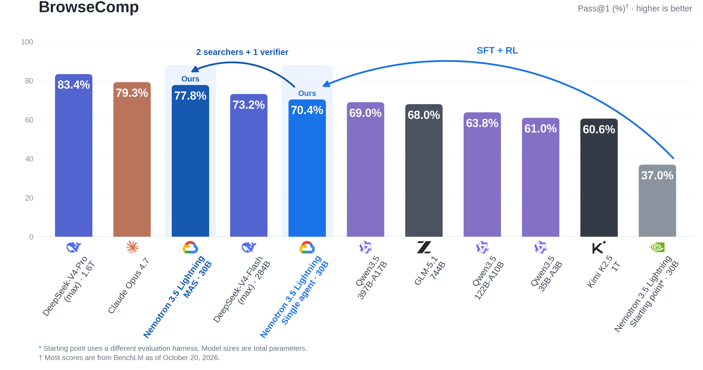

  <em>Figure 1. BrowseComp pass@1. The single-agent and MAS configurations share the same post-trained checkpoint.</em>

## Background

In this post, we evaluate our search agents on [BrowseComp](https://openai.com/index/browsecomp/), a challenging and widely used benchmark for agentic web search. It is featured in evaluations of frontier systems such as [Gemini Deep Research](https://blog.google/innovation-and-ai/technology/developers-tools/deep-research-agent-gemini-api/) and [Claude](https://www.anthropic.com/news/claude-opus-4-6). Its 1,266 questions are designed to require persistent investigation, often involving indirect clues and evidence scattered across multiple sources. The answers are short and verifiable, making the benchmark useful for comparing how reliably agents can complete difficult searches. In the [original human evaluation](https://arxiv.org/html/2504.12516v1#S3), participants gave up on 70.8% of attempted questions after spending at least two hours searching per question.

<strong>BrowseComp Example</strong>

Using the clues below, identify the last person thanked in the acknowledgments of a paper published in 2001. Give the name exactly as printed in that paper.

- An article from 2020–2023 describes animals attempting to bite a speaker when different sounds were played through it.
- The same writer published another article during 2012–2022, discussing a new research approach that uses artificial intelligence.
- That second article mentions a paper published during 2016–2021.
- The last-listed author of that paper co-authored another paper in 2001, which appeared in volume 68.

*All year ranges are inclusive.*

## Data Synthesis Pipeline

To post-train a search agent, we need challenging questions with verifiable answers, together with successful trajectories that demonstrate how to solve them. SFT learns from these demonstrations, while RL uses the questions and their supporting evidence to evaluate the agent's own search attempts. To produce this data at scale, we build a self-improving synthesis loop. The loop generates questions from source evidence, tests them with a search agent, and uses the resulting feedback to revise ambiguous constraints, eliminate shortcuts, and calibrate difficulty. We run this synthesis loop in a local search environment to make task generation and trajectory collection affordable at scale.

### High-Fidelity Local Search Environment

The local environment must provide the evidence needed to solve the tasks: missing supporting documents can cause a rollout to fail even when the agent searches appropriately. We therefore calibrate local retrieval and snippets against live APIs while keeping the corpus fixed across runs.

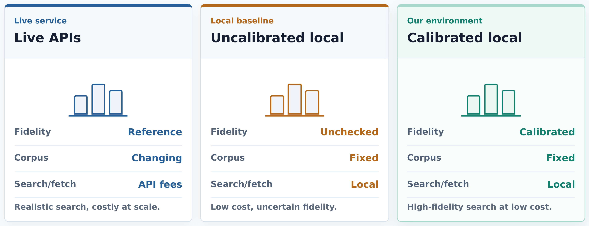

*Figure 2. Both local configurations use fixed corpora and local search and fetch. Calibration checks evidence recall and snippet quality against live API responses.*

Our local search environment contains about 645 million documents: 637.9 million from the three latest [FineWeb](https://huggingface.co/datasets/HuggingFaceFW/fineweb) snapshots and 7.18 million [Wikipedia pages](https://dumps.wikimedia.org/enwiki/20260501/).
Documents from these sources are normalized into records containing a document identifier, title, URL, and full text; the full deployment uses approximately 5 TB of storage.

To search this corpus, we apply [BM25](https://doi.org/10.1561/1500000019) independently to full documents, passages, and titles. Full-document retrieval matches query terms across a page, while passage retrieval helps surface evidence concentrated in a small section of a long document. Title retrieval provides an additional signal for queries targeting specific entities. We map passage hits back to their parent documents and remove duplicate parents while preserving retrieval order.

We combine the resulting document rankings using weighted [reciprocal rank fusion (RRF)](https://doi.org/10.1145/1571941.1572114). This combines rankings without requiring BM25 scores from the three retrieval views to share a common scale. The rank constant and fusion weights are tuned on a local held-out set, and for a given query, the fused score of document $d$ is:

$$
\mathrm{RRF}(d) = \frac{1.0}{5+r_{\mathrm{doc}}(d)} +
\frac{0.75}{5+r_{\mathrm{passage}}(d)} +
\frac{0.75}{5+r_{\mathrm{title}}(d)}.
$$

Here, $r_{\mathrm{doc}}(d)$, $r_{\mathrm{passage}}(d)$, and $r_{\mathrm{title}}(d)$ are the document's ranks in the three lists, starting at 1. Passage ranks refer to the document list after parent mapping and deduplication; a document absent from a list receives zero contribution from that list. Higher-ranked documents receive larger contributions, and documents retrieved through multiple views accumulate contributions across lists.

For each candidate document, we construct a query-focused snippet from its stored text. We score 64-word sliding windows with BM25, giving priority to exact matches of quoted query phrases. We then extract a contiguous excerpt of up to 48 words around the query matches, preserving complete sentences where the word budget allows. An LLM reranker uses the research context and each candidate's title, URL, and snippet to order results by their usefulness for the agent's next research step.

The agent invokes this retrieval pipeline through the `search` tool. Our query parser supports keyword search, exact phrase constraints expressed in double quotes, and a single `site:` filter per query to restrict retrieval to a domain and its subdomains. To examine selected results, the agent calls `visit` with an information goal that guides evidence extraction from the underlying documents.

| Tool | Input | Returned observation |
| --- | --- | --- |
| `search(query)` | `query` (`list[str]`): one or more search queries. | Ranked results, each containing a `ref_id`, title, URL, and snippet. |
| `visit(ref_id, goal)` | `ref_id` (`list[str]`): one or more reference IDs returned by `search`. `goal` (`str`): an agent-written description of the information to look for. | Evidence relevant to `goal` and a page summary for each selected document, produced by an auxiliary language model. |

The local and live environments expose the same tools. Local visits read stored documents; live visits fetch web pages. The agent can therefore practice query reformulation and selective reading locally using the same interface it will use during live evaluation.

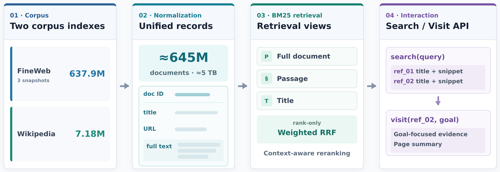

*Figure 3. Local search environment built on FineWeb and Wikipedia. After document normalization, BM25 retrieves candidates using full-document, passage, and title views. Weighted RRF and LLM reranking produce the results returned by `search`; `visit` extracts evidence and summarizes selected documents according to the agent's goal.*

We assess the fidelity of the local environment through evidence coverage and snippet quality. On held-out queries from live-API rollouts, local retrieval recovers roughly 74% of the reference evidence targets within its top ten results. We also compare local and live snippets for 500 matched query/URL pairs using a blind LLM judge. The judge prefers local snippets in 48.5% of non-tied cases, close to an even split with live snippets.

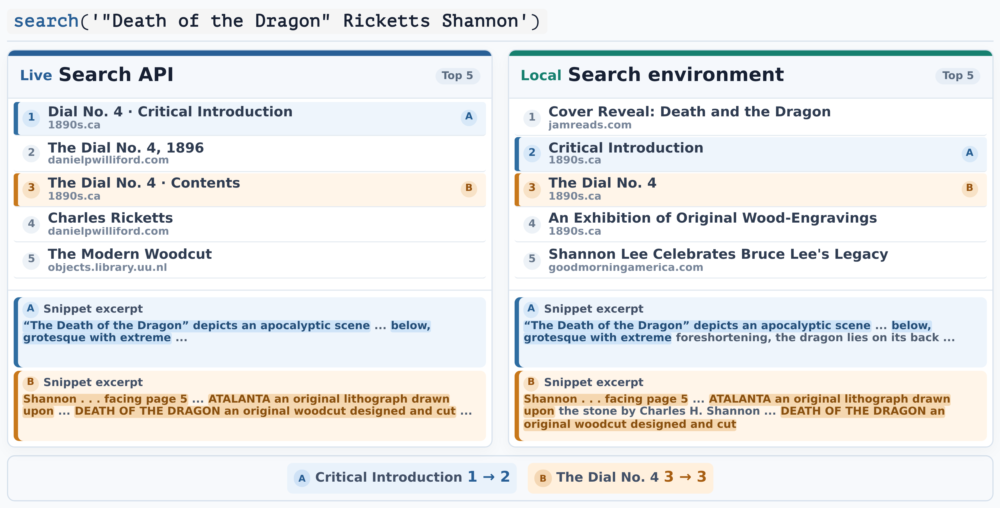

*Figure 4. Live and local search results for the same query. Colored markers identify shared evidence pages, and highlights show overlapping text in their snippets. Ellipses indicate omissions made for display.*

In our experiments, all SFT demonstrations and RL rollouts were collected locally, and the trained agent generalized directly to live web search on BrowseComp.

### From Evidence Graphs to Search Tasks

To construct questions that require combining evidence across pages, we start from Wikipedia's hyperlink graph. Pages are first sampled across domains and entity types to seed graph expansion. Their neighborhoods are expanded along edges with associated source text, and the resulting subgraphs are filtered by size. The retained subgraphs, called anchor graphs, provide the structural foundation and source material for factual claim extraction and question generation.

Within each anchor graph, the text surrounding a hyperlink provides evidence about the relationship between the linked pages' subjects. An LLM extracts factual relations from these passages as claims, using page titles and descriptions to disambiguate the entities involved. Each claim records its subject, relation, and object, together with a reference to the supporting passage.

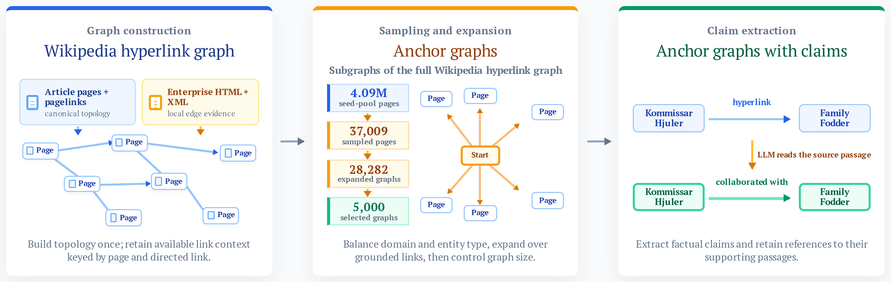

*Figure 5. Wikipedia hyperlinks provide graph structure, while the surrounding text supplies evidence for claims. We sample anchor graphs across domains and entity types, then annotate their links with claims extracted from the source passages. Counts show the initial graph-construction run.*

Once claims have been extracted, we select candidate answers from the anchor graph. These need not correspond to the page that seeded graph expansion. For each candidate answer, we first identify pages whose claims establish a direct relation to it, then find multi-hop paths that reach the answer through those pages. The selected pages, paths, and supporting claims form an evidence graph centered on the answer. Its claims provide the factual basis for question constraints, while the reference answer and supporting evidence are retained for verification.

Figure 6 illustrates a real evidence graph with Fulham Town Hall as the candidate answer. The two highlighted paths begin with John Wenham and Werner Kissling and reach the answer through George Edwards and Christina Broom, respectively. Along the first path, the supporting claims include Wenham's service as curate at St Paul's Church, Hadley Wood, and Edwards's design of Fulham Town Hall between 1888 and 1890.

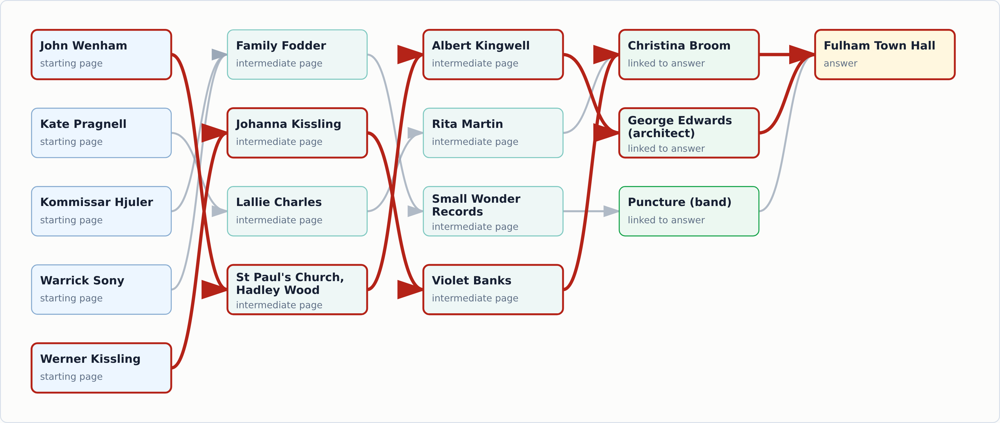

*Figure 6. An evidence graph centered on Fulham Town Hall. Nodes represent Wikipedia pages. Red edges and node borders mark the two evidence paths selected for question generation; gray edges show the remaining connections.*

The generator combines selected claims from the evidence graph into clues for a natural-language question. It records the evidence paths and starting entities used, so that reviewers can trace each clue back to its source passage. The reference answer and evidence graph are retained for verification. The solver receives only the question and is not required to follow the paths used to generate it.

### Task Synthesis Loop

A question built from source evidence can still be ambiguous or solvable with a single search query. We therefore use a synthesis loop to assess whether the clues identify a unique, recoverable answer and whether solving the question requires evidence from multiple pages. Feedback from review and search attempts guides the generator's revisions to the question and its evidence choices.

Within this loop, a controller processes generated questions in batches and performs initial checks before critic review. It checks each candidate's evidence references and screens for answer leakage and search shortcuts. In our initial collection recipe, questions containing the exact title of the answer page are rejected. The controller also probes whether simple queries retrieve that page or a directly connected page in the evidence graph.

Candidates that pass these checks proceed to critic review, which evaluates wording, the amount of identifying information revealed, constraint clarity, difficulty, and grounding in the evidence paths. A candidate rated below excellent on any dimension returns to the generator with diagnostic feedback for revision. Among candidates rated excellent on all five dimensions, the controller uses the critic's ranking to select the next question for a solver attempt.

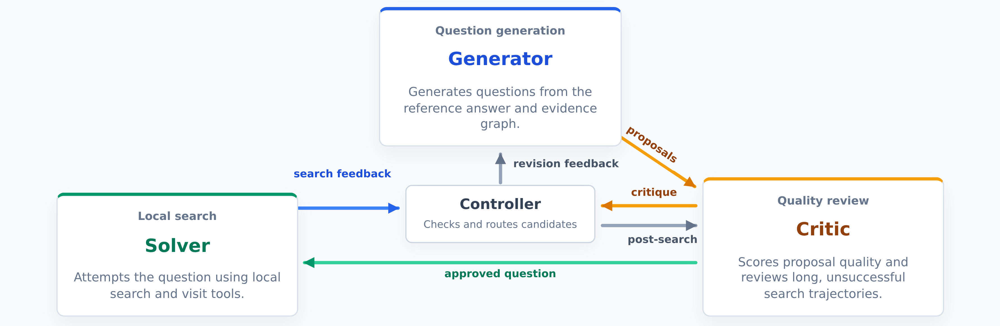

*Figure 7. The task synthesis loop. The generator proposes questions from a reference answer and evidence graph. The critic reviews candidates, and the solver attempts approved questions in the local search environment. Arrows show information flow between roles. The controller performs initial checks, coordinates the loop, and returns feedback for revision; long unsuccessful attempts trigger an additional validity review.*

For questions that pass critic review, we use solver rollouts to assess answer correctness and search effort. In our initial collection recipe, acceptance requires a correct answer after at least 50 search and visit calls in total. Questions answered correctly with fewer calls return to the generator as too easy; unsuccessful attempts below the same threshold also return for revision with rollout feedback. Tool-call count serves as a proxy for search difficulty under the chosen solver and local search environment.

An incorrect answer after at least 50 tool calls can reflect either task difficulty or a flaw in the question. The critic therefore reviews both the question and the failed trajectory. By default, a question is retained as a potentially hard candidate only if all three sampled reviews judge it valid with high confidence. These candidates remain separate from accepted successes, and the controller continues the loop within its search and revision budgets. Solver feedback passed to the generator includes the answer, tool-call count, and recent search and visit actions, which guide revisions to the question and its evidence choices.

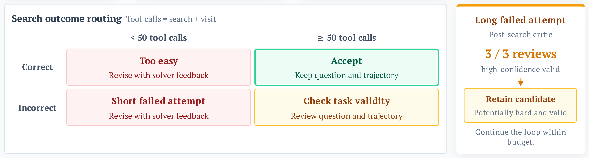

*Figure 8. Controller decisions based on answer correctness and the total number of search and visit calls. A question is accepted only after a correct answer with at least 50 calls. Following a long failed attempt, the question is retained for further attempts only if all three sampled critic reviews judge it valid with high confidence.*

Applying these acceptance criteria, our initial collection run yielded a question-answer (QA) pair from 13,321 of 14,611 evidence graphs, a graph-to-QA success rate of 91.2%. Repeated generation and revision produced 695,056 proposals in total; Figure 9 shows their progression through the filtering stages. The accepted solver trajectories used a median of 76 search and visit calls and a mean of 91.

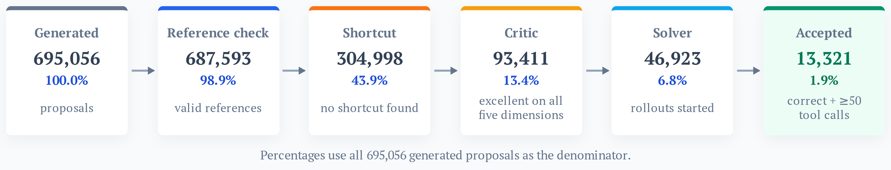

*Figure 9. Proposal filtering in the initial collection run. Critic-approved candidates are ranked before selection for solver rollouts. All percentages are relative to the 695,056 generated proposals. The final 1.9% acceptance rate is measured per proposal; the 91.2% success rate reported in the text is measured per evidence graph, which can produce multiple proposals.*

Two accepted questions are shown below, abridged for readability.

<strong>Generated task · Historical geography and museum architecture</strong>

Quarried stone from a volcanic formation was used to build a museum dedicated to a 19th-century independence figure. The rebellion sparked by this figure saw reinforcements from the target settlement arrive four days after the initial engagement. This settlement is a provincial capital and shares its name with a short-lived foreign department. Identify this provincial capital.

The private reference answer is **Tarata, Peru**. The successful rollout used 97 tool calls: 69 searches and 28 visits.

<strong>Generated task · A Modernisme teaching lineage</strong>

Determine the identity of a 19th-century Spanish master whose pedagogy influenced a painter who later taught a young Modernisme artist. This young artist's unfinished works were retrieved from Paris in 1915 by a fellow painter who used them to seed a museum collection. Who is the original master teacher?

The private reference answer is **Ramon Martí Alsina**. The successful rollout used 56 tool calls: 38 searches and 18 visits.

Each accepted question is stored with its reference answer, verification result, and successful solver trajectory. The trajectory records the agent's decisions, tool arguments, returned observations, and final answer in execution order. The private evidence graph is retained separately for verification.

These accepted questions form the task pool for collecting SFT demonstrations, with multiple teacher rollouts generated per question in the local environment. For RL, we extend the same synthesis loop to produce a new question pool with additional verification, on which the student collects its own rollouts.

## Training

We post-train Nemotron 3.5 Lightning with SFT followed by RL using [NeMo-RL](https://github.com/NVIDIA-NeMo/RL). SFT trains the model on complete teacher demonstrations, supervising intermediate reasoning and tool use as well as final answers. RL then refines this policy through the model's own search attempts, rewarding answer correctness and coverage of required supporting facts in the final report. Both stages use consistent tool formats and sliding-window context management. RL runs asynchronously, allowing completed groups of rollouts to contribute to updates while slower groups continue searching.

### Supervised Fine-Tuning (SFT)

#### Training Data and Objective

We collect three teacher rollouts for each of the 13,321 synthesized tasks in the local search environment. Trajectories are retained if they reach the correct answer and pass checks for completeness and tool use. The resulting dataset contains 32,460 training trajectories and 97 validation trajectories.

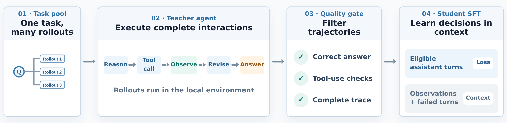

*Figure 10. Teacher rollouts are collected in the local search environment and filtered for answer correctness, completeness, and tool use. Successful trajectories can include recoveries from tool errors. Only eligible assistant turns contribute to the loss; tool observations and failed turns remain as context.*

SFT supervises the assistant's reasoning, tool calls, and final answers; system messages, user messages, and tool observations provide context only. When a successful trajectory includes recovery from an invalid tool call, the failed assistant turn is excluded from the loss. The corrected action is supervised with the failed action and error feedback still visible.

For the trajectories $\mathcal{B}$ in one optimizer update, we minimize the masked negative log-likelihood:

$$
\mathcal{L}_{\mathrm{SFT}}
= -\frac{\sum_{i\in\mathcal{B}}\sum_t m_{i,t}\log\pi_\theta(x_{i,t}\mid h_{i,t})}
{\sum_{i\in\mathcal{B}}\sum_t m_{i,t}}.
$$

Here, $x_{i,t}$ is token $t$ from trajectory $i$, $h_{i,t}$ is the history visible to the model when predicting that token, and $\pi_\theta$ is the student model. The mask $m_{i,t}$ is one for eligible assistant tokens and zero otherwise. Normalization is over all eligible tokens in the update, giving each supervised token the same weight.

#### SFT Recipe and Results

Long search histories are managed with a sliding-window approach: recent tool observations are retained in full, while older observations are replaced with short omission markers. The system instructions, question, and the assistant's reasoning and tool-call history remain intact. The same context-management policy is used during SFT preparation and rollout.

We train for one epoch using distributed Muon and a cosine learning-rate schedule, with 64 trajectories per optimizer update and 507 updates in total.

| Setting | SFT recipe |
| --- | --- |
| Base model | Nemotron 3.5 Lightning, 30B-A3B, BF16 |
| Context / packing capacity | 262,144 tokens |
| Batch size | 64 trajectories per update; microbatch size 1 |
| Optimizer | Distributed Muon; weight decay 0.1 |
| Learning rate | $5\times10^{-5}$ peak, $10^{-6}$ minimum |
| Schedule | 51 warmup updates, cosine decay through update 507 |
| Muon settings | Momentum 0.9; spectral scaling, multiplier 0.2; Nesterov off |
| Hardware | 16 nodes × 8 GPUs |
| Parallelism | TP=2, CP=8, EP=8, PP=1 |
| Memory management | Sequence packing and full activation recomputation |

  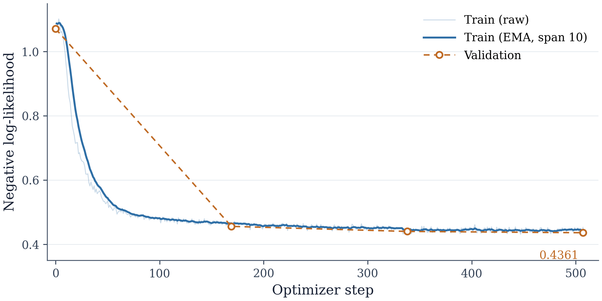

*Figure 11. SFT negative log-likelihood. Training is shown per update (faint) and with an exponential moving average of span 10 (solid). Validation markers show the four recorded evaluations; dashed lines are guides between observations.*

Validation negative log-likelihood decreases from 1.071 to 0.436 over the training epoch (Figure 11). On our internal evaluation set, pass@1 improves from **37.85%** before SFT to **67.11%** after SFT. The final checkpoint serves as the initialization for RL.

### Reinforcement Learning (RL)

Starting from the SFT checkpoint, we train on 5,025 new questions generated by an expanded version of the task synthesis loop. Before accepting a question, we check its constraints against the source evidence and use search to verify the reference answer and look for valid alternatives. Questions with unsupported clues or unresolved ambiguity are returned for revision.

Generating questions that are both valid and difficult for the SFT model remains challenging: the initial policy achieves roughly **80% pass@1** on this new training pool. We sample four search trajectories per question and compute group-relative advantages from their rewards. When all four answers have the same correctness outcome, an outcome-only reward produces zero advantages, even when the final reports establish different subsets of the required facts. We therefore combine answer correctness with coverage of required supporting facts in the final report.

#### Outcome and Claim Rewards

For each question, we identify the factual claims needed to justify the reference answer under the question's constraints. Before training, an auxiliary judge selects these required claims from the private reference answer and supporting evidence in five independently sampled calls. We retain claims selected in at least three calls, then use one refinement call to remove incidental details while preserving the required relationships and conditions. The resulting claim set stays fixed throughout RL and is used only for reward computation; it is never included in the policy's prompt.

For each completed rollout, a Qwen3.6-35B-A3B-FP8 judge checks which required claims are stated or entailed by the final report, accepting semantic paraphrases. For example, naming both an architect and a town hall does not establish that the architect designed the building. We use seven independently sampled judgments per report and count each distinct claim once if at least five agree that it is established. Facts appearing only in the agent's reasoning or tool observations receive no credit. Claim reward measures coverage in the final report without evaluating the search path.

The outcome reward $y_i\in \lbrace 0,1 \rbrace$ scores answer correctness against the task's reference answer and is labeled rollout reward in the training curves. The claim reward $c_i\in[0,1]$ is the fraction of required claims established in the final report of rollout $i$. For each group of four rollouts, we combine the rewards into a total reward $r_i$ and subtract the group mean to obtain the advantage:

$$
r_i = 0.6\thinspace y_i + 0.4\thinspace c_i,
\qquad
A_i = r_i - \frac{1}{4}\sum_{j=1}^{4}r_j.
$$

The 0.6/0.4 weighting ensures that every correct answer scores above every incorrect answer: their reward ranges are $[0.6,1.0]$ and $[0,0.4]$, respectively. Within either outcome, greater claim coverage receives higher reward. For a task with no required claims, we set coverage to one, so only correctness creates differences within the group.

Like [Dr. GRPO](https://arxiv.org/abs/2503.20783), we compute advantages by subtracting the group mean without dividing by the group standard deviation. This preserves the scale of reward differences across questions. For our claim reward, it also avoids amplifying small coverage differences that may reflect noise in the judge's decisions.

Each complete rollout receives one reward, and its advantage is applied to all eligible assistant tokens in that trajectory. Tool observations provide context but carry no loss. The policy loss is normalized separately: token-level contributions are summed across the entire optimizer update and divided by the total number of eligible assistant tokens, without first averaging within each trajectory.

#### Task Sampling

We shuffle the training questions and score each group of four rollouts using the combined outcome and claim reward. Dynamic sampling excludes a group from optimization when all four advantages are zero, since it provides no policy-gradient signal. Groups in which all four answers are correct or all four are incorrect remain eligible when their reports differ in claim coverage.

Excluding a rollout group does not prevent its question from being sampled again. The recipe allows a second pass over the question pool, skipping only questions for which all four first-pass rollouts answered correctly and established every required claim. Questions with incomplete claim coverage remain eligible for fresh rollouts, even if all four answers were correct and the first group produced zero advantages.

#### Asynchronous Training

Search rollout groups have widely varying completion times. Across 1,600 four-rollout groups used in training, the time from the first rollout's start to completed reward scoring had a median of 23.6 minutes and a 99th percentile of 91.7 minutes. Synchronous updates must wait for the slowest group in each batch.

Generation and optimization run on separate workers under a ready-first schedule. All four trajectories in a group must be complete and scored before the group can be selected for training. The trainer combines ready groups from different dispatch batches and policy versions, while slower groups continue running.

Gradient computation can begin once eight groups are ready. The trainer accumulates gradients from 32 groups, or 128 trajectories, before applying an optimizer update. This lets training proceed without waiting for all groups from any one dispatch batch to finish.

  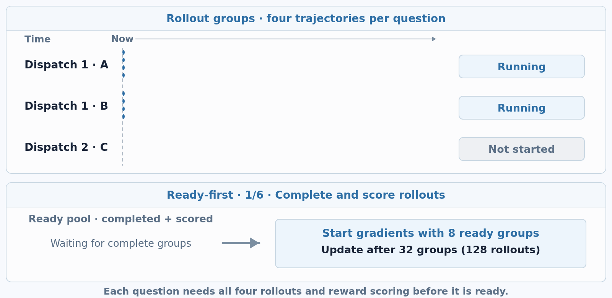

*Figure 12. Ready-first scheduling. Each letter denotes one question with four rollouts. Blue bars indicate running rollouts; teal bars indicate completed rollouts. A group becomes ready only after all four finish and rewards are computed. A and C, from different dispatches, can contribute to the same update while B remains in flight. The `6 others` and `+8` labels summarize omitted groups with illustrative arrival sizes. Timing is schematic, with pauses at key events.*

The scheduler limits new dispatches to eight batches ahead of the trainer's current update. This admission limit controls how far generation can run ahead; already-dispatched groups remain selectable when they finish, even if training has advanced beyond that window.

As generation continues alongside training, a long rollout can span multiple policy versions. We therefore record the policy version that generated each assistant token and apply a separate token-age limit. At learner version $v$, a token generated at version $v_t$ contributes to the loss only when $v-v_t\leq8$. Older tokens remain visible as context but receive zero loss, allowing later turns to remain trainable even when earlier turns have become stale. When generation workers receive updated weights, they recompute the cached context before continuing generation.

For tokens that remain eligible, we account for changes in policy probabilities using the recorded token IDs and sampling log-probabilities. For assistant token $a_{i,t}$ in trajectory $i$, with visible history $h_{i,t}$, the importance weight is

$$
w_{i,t} = \frac{\pi_\theta(a_{i,t}\mid h_{i,t})}{\pi_{\mathrm{gen},i,t}(a_{i,t}\mid h_{i,t})},
$$

where $\pi_\theta$ is the current training policy and $\pi_{\mathrm{gen},i,t}$ is the policy that generated the token. We apply [IcePop](https://arxiv.org/abs/2510.18855)-style filtering, setting the weight to zero outside $[0.2,5]$ and retaining its original value inside that interval. Version masking limits token age, while IcePop filters large relative changes in token probability.

Combining these choices, the policy update has the same gradient as the following surrogate objective:

$$
\widetilde{w}_{i,t} = w_{i,t}\thinspace \mathbf{1}\negthinspace \left[0.2\leq w_{i,t}\leq5\right],
$$

$$
\mathcal{L}_{\mathrm{PG}} = -\frac{\sum_{i,t}m_{i,t}\thinspace \mathrm{sg}\negthinspace \left(A_i\widetilde{w}_{i,t}\right)\log\pi_\theta(a_{i,t}\mid h_{i,t})}{\sum_{i,t}m_{i,t}}.
$$

Here, $\mathrm{sg}$ stops gradients through the advantage and importance weight. The mask $m_{i,t}$ selects eligible assistant tokens and excludes tokens more than eight policy versions old. Prompt tokens and tool observations carry no loss. The denominator counts these eligible tokens across the full optimizer update, including tokens whose contribution IcePop sets to zero. IcePop therefore changes the weighted contributions without renormalizing the denominator.

This global token mean gives each eligible token the same base weight before its advantage and importance weight are applied. Trajectories with more eligible tokens contribute more terms to the update. During streaming training, we accumulate unnormalized gradient sums and apply the shared denominator once the full update has been assembled. Each retained trajectory is used in one optimizer update.

#### RL Recipe and Results

We use distributed Muon with a constant learning rate of $2\times10^{-6}$.

| Setting | RL recipe |
| --- | --- |
| Initialization | SFT checkpoint |
| Questions / rollouts per update | 32 / 128 |
| Rollout budget | Up to 500 agent steps; 32,768 output tokens per assistant call |
| Sampling | Temperature 1.0, top-p 1.0 |
| Context policy | 262,144-token limit; sliding-window management of tool observations |
| Reward | $0.6\times$ answer correctness $+\mkern5mu 0.4\times$ claim coverage |
| Advantage normalization | Subtract group mean; no division by standard deviation |
| Loss normalization | Global mean over eligible assistant tokens across the full update |
| Claim judging | Seven judgments per report; five votes required per claim |
| Staleness controls | Admission window: 8 dispatch batches; token age limit: 8 policy versions |
| Importance weights | Token-level IcePop; zero weights outside $[0.2,5]$ |
| PPO ratio clipping | Disabled |
| Reference-policy KL | Coefficient 0 |
| MoE routing | Frozen router; replay recorded routing during the training forward pass |
| Optimizer | Distributed Muon; constant LR $2\times10^{-6}$; weight decay 0.1 |
| Muon settings | Momentum 0.9; spectral scaling, multiplier 0.2; Nesterov on |
| Training parallelism | TP=2, CP=8, EP=8, PP=1 |
| Resource allocation | 10 training nodes, 7 generation nodes, 4 shared auxiliary nodes; 8 GPUs per node |
| Auxiliary work | Search-result reranking, visit summaries, outcome judging, and claim judging |

Figure 13 shows running averages of the training rewards, with each update averaged over its 128 retained trajectories. Both answer correctness and required-claim coverage increase overall, with intermediate plateaus and declines. The question groups contributing to these averages change with task sampling.

  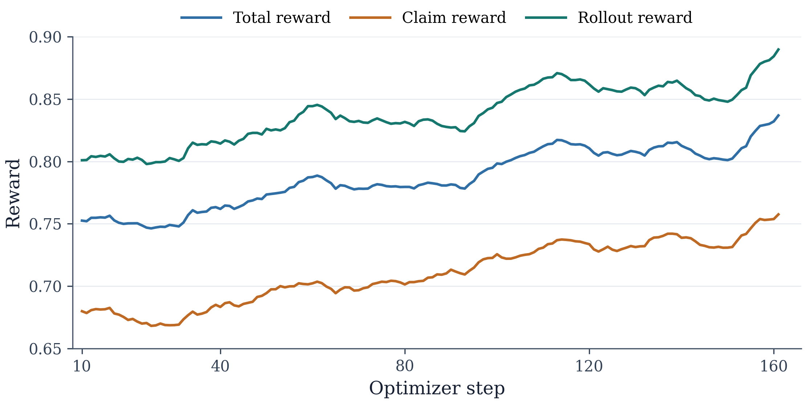

*Figure 13. RL reward trends (running averages). Rollout reward measures answer correctness, claim reward measures required-claim coverage, and total reward combines them with weights 0.6 and 0.4.*

On the same internal evaluation set used to assess SFT, pass@1 improves from **67.11%** for the SFT model to **74.46%** after RL, a gain of **7.35 percentage points**.

### Evaluation

We track post-training progress on our internal evaluation set and evaluate transfer to live web search on BrowseComp. All scores below are pass@1.

| Setting | Internal Eval Set | BrowseComp |
| --- | --- | --- |
| Baseline (before SFT) | 37.85% | 37.0%\* |
| SFT, single agent | 67.11% | — |
| RL, single agent | 74.46% | 70.4% |
| RL, multi-agent system (MAS) | — | 77.8% |

\*The baseline BrowseComp score was obtained using a different evaluation harness.

The RL-trained agent achieves **70.4% pass@1** on BrowseComp. To extend its search at inference time, we use two independent searchers and a verifier, all powered by the same checkpoint. Each searcher investigates the question and returns its trajectory and answer. The verifier examines both attempts and performs additional searches to check the proposed answers against the evidence. It returns one final answer per question, which is used to compute system pass@1. This configuration reaches **77.8%**, **7.4 percentage points** above the single-agent result.

## Key Takeaways

- Verification and solver feedback guide the synthesis of difficult, verifiable search tasks. Evidence graphs ground the clues, while critic reviews and solver attempts expose ambiguity and shortcuts. The generator uses these findings to revise the questions and their evidence choices throughout the synthesis loop.

- Agents post-trained entirely in a local search environment can generalize to live web search. Using consistent tool interfaces and calibrated local retrieval and snippets, we collect all SFT demonstrations and RL rollouts locally. The resulting 30B agent achieves **70.4% pass@1** on BrowseComp with live search.

- Post-training must address both long trajectories and sparse rewards. SFT establishes an initial search policy, which RL improves through further search attempts. Claim coverage distinguishes reports with the same answer-correctness outcome, while ready-first scheduling lets completed rollout groups contribute to updates as slower searches continue.

- Search and verification with the same checkpoint can further improve performance at inference time. Two independent searchers investigate each question, and a verifier performs additional searches to check their proposed answers. This configuration raises BrowseComp pass@1 from **70.4%** for a single agent to **77.8%** for the system.

## Acknowledgements

We thank Guanghao Mei, Jun-Liang Lin, Mohammadreza Mohseni, Weiran Zhao, Jiuqiang Tang, and Pooya Moradi, our teammates on the Gemini Enterprise Agent Platform training clusters team, for their infrastructure support, feedback, and insightful discussions throughout the project. We also thank Bo Wu, Ting Yu, Shengyang Dai, and Peng Xu for their leadership and support.
