
  

# Post-Training Conversational Agents via Self-Evolving Data Synthesis

**Authors:** [Guanghao Mei](mailto:ghmei@google.com), [Weiran Zhao](mailto:weiranzhao@google.com), [Jun-Liang Lin](mailto:junlianglin@google.com), [Siqi Miao](mailto:siqim@google.com), [Xuehan Xiong](mailto:xxman@google.com)

## Table of Contents

* [1. Introduction](#1-introduction)
* [2. Task Formulation and Benchmark](#2-task-formulation-and-benchmark)
    * [2.1 Task Formulation](#21-task-formulation)
    * [2.2 The &tau;3-Banking Benchmark](#22-the-τ3-banking-benchmark)
* [3. Self-Evolving Data Synthesis Pipeline](#3-self-evolving-data-synthesis-pipeline)
    * [3.1 Prebuilt Entity Graph and Tool Graph](#31-prebuilt-entity-graph-and-tool-graph)
    * [3.2 Task Generation and Evolution](#32-task-generation-and-evolution)
    * [3.3 Evolving Towards Real-World Tasks](#33-evolving-towards-real-world-tasks)
    * [3.4 Constructing SFT and RL Datasets](#34-constructing-sft-and-rl-datasets)
* [4. Training Recipe](#4-training-recipe)
    * [4.1 Policy Parameterization and Objective](#41-policy-parameterization-and-objective)
    * [4.2 Two-Stage Optimization: SFT and GRPO](#42-two-stage-optimization-sft-and-grpo)
    * [4.3 Harness](#43-harness)
    * [4.4 Efficiency](#44-efficiency)
* [5. Experiments](#5-experiments)
    * [5.1 Experimental Setup](#51-experimental-setup)
    * [5.2 Main Results](#52-main-results)
    * [5.3 Comparison with Open-Weight and Frontier Models](#53-comparison-with-open-weight-and-frontier-models)
* [6. Key Takeaways](#6-key-takeaways)
* [Acknowledgements](#acknowledgements)

## 1. Introduction

Welcome to the fourth installment of our blog series on model training best practices for customers of [Gemini Enterprise Agent Platform training clusters](https://docs.cloud.google.com/gemini-enterprise-agent-platform/machine-learning/training/training-clusters/overview). Large language models (LLMs) have evolved from generic next-token predictors to autonomous agents. Unlike question-answering chatbots, enterprise conversational agents in domains such as banking support and IT helpdesks must coordinate unstructured knowledge retrieval with multi-step tool execution. Across multi-turn interactions, an agent must retrieve domain-specific rules from interconnected policy documents, proactively elicit missing user information, and invoke internal tools to execute policy-compliant state updates.

Despite their potential in business, executing such long-horizon, rule-constrained interactions reliably remains a major challenge. On &tau;3-Banking, a realistic banking support benchmark, even the highest-performing model solves only about half of the tasks. Errors frequently arise when an agent must resolve implicit cross-turn dependencies, orchestrate interdependent function calls, or enforce policies that conflict with user preferences.

Post-training provides a promising path to adapting models to such domain-specific policies and multi-turn tool workflows. However, post-training open-weight models into effective conversational agents remains challenging due to three fundamental constraints: (i) public corpora lack high-quality multi-turn tool-use trajectories; (ii) manually collecting and verifying domain-specific interaction traces is prohibitively slow and costly; and (iii) multi-turn agentic reinforcement learning (RL) requires long interactive rollouts that bottleneck training throughput. To overcome these constraints, we introduce a [self-evolving data synthesis pipeline](#3-self-evolving-data-synthesis-pipeline) that synthesizes verifiable multi-turn tasks from an unstructured knowledge base and tools, paired with an end-to-end [post-training recipe](#4-training-recipe) combining supervised fine-tuning (SFT), RL, and a unified execution harness on Gemini Enterprise Agent Platform training clusters. We apply this recipe to the [NVIDIA Nemotron](https://www.nvidia.com/en-us/ai-data-science/foundation-models/nemotron/) family of open models including recently released [NVIDIA Nemotron 3.5 Super VL](https://blogs.nvidia.com/blog/nemotron-3-5-super-vl/) and NVIDIA Nemotron 3.5 Lightning models using [NVIDIA NeMo RL](https://docs.nvidia.com/nemo/rl/latest/index.html) and [NeMo Gym](https://github.com/NVIDIA-NeMo/gym), open-source post-training and evaluation libraries within the [NVIDIA NeMo Framework](https://github.com/nvidia-nemo), running on NVIDIA AI infrastructure managed by [Gemini Enterprise Agent Platform training clusters](https://docs.cloud.google.com/gemini-enterprise-agent-platform/machine-learning/training/training-clusters/overview) training clusters.

The main contributions of this blog are summarized as follows:

1. **State-of-the-art performance within size classes:** We improve `Nemotron-3.5-Lightning-30B-A3B` from 7.6% to 32.5% and `Nemotron-3.5-Super-VL-120B-A12B` from 15.1% to 44.0% on &tau;3-Banking, outperforming all 2026 open-weight models in their respective size classes, with our post-trained `Nemotron-3.5-Super-VL-120B-A12B` model achieving performance competitive with frontier models.
2. **A self-evolving data synthesis pipeline:** We compile unstructured policy documents and tools into structural dependency and entity graphs, decoupling programmatic state construction from natural-language generation with task-level and pipeline-level evolution.
3. **An efficient end-to-end post-training recipe:** We deliver SFT and RL recipes within a unified training and evaluation harness, incorporating systems optimizations that accelerate agentic RL.

<figure align="center" id="fig-teaser">
<table align="center" width="100%">
  <tr>
    <td align="center" width="100%">
      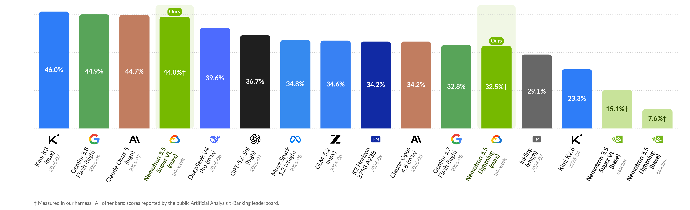 
    </td>
  </tr>
</table>
<figcaption align="left">
<b>Figure 1: &tau;3-Banking pass@1 comparison with frontier models.</b> <i>Post-trained with our self-evolving synthetic data recipe, Nemotron-3.5-Super-VL-120B-A12B and Nemotron-3.5-Lightning-30B-A3B achieve competitive performance against proprietary frontier models. This figure is for reference only. †: evaluated in our harness; all other results are from the public Artificial Analysis &tau;3-Banking leaderboard.</i>
</figcaption>
</figure>

---

## 2. Task Formulation and Benchmark

### 2.1 Task Formulation

Multi-turn interactions between an AI assistant and a user present unique challenges that go beyond single-turn tasks. We formulate each task as a two-player turn-taking interaction between an agent and a user within a decentralized partially observable Markov decision process (Dec-POMDP). A task instance $q = (u, s^{\text{db}} _ 0, A^\star) \sim 𝒟$ sampled from the task distribution $𝒟$ comprises a natural-language user scenario $u$, an initial relational database state $s^{\text{db}} _ 0$, and a sequence of ground-truth reference actions $A^\star$. At turn $t$, the environment state $s_t = (s^{\text{db}} _ t, h_t)$ pairs the mutable database state $s^{\text{db}} _ t$ with the cumulative interaction history $h_t$, initialized at $s^{\text{db}} _ 0$ with an empty history $h_0$.

At each turn $t$, the active player executes an action $a_t$, which is either an agent action $a^{\text{agent}} _ t$ or a user action $a^{\text{user}} _ t$. The agent emits a message or invokes a tool from its active toolset $𝒯^{\text{agent}} _ t$; the user emits a message or invokes a delegated user-side tool from the user toolset $𝒯^{\text{user}}$. The transition operator $P(s _ {t+1} \mid s_t, a_t)$ updates $s^{\text{db}} _ t$ upon write-tool execution, leaves $s^{\text{db}} _ t$ invariant under read tools and messages, and appends the action and its output to $h_t$. At the terminal turn $T$ (triggered by user termination or step-budget exhaustion), the environment assigns a binary exact-match reward $R(s_T) \in \lbrace 0, 1 \rbrace$:

$$
R(s_T) = 𝟏\big[\thinspace  s^{\text{db}}_T = s^{\text{db}}_\star \thinspace \big], \qquad
s^{\text{db}}_\star = \mathrm{Exec}(s^{\text{db}}_0, A^\star), \qquad (1)
$$

where $𝟏[\cdot]$ denotes the indicator function, $s^{\text{db}} _ T$ is the terminal database state, and $s^{\text{db}} _ \star$ is the target database state produced by the deterministic execution operator $\mathrm{Exec}(s^{\text{db}} _ 0, A^\star)$ when replaying $A^\star$ on $s^{\text{db}} _ 0$. We evaluate policies via pass@1, the expectation of $R(s_T)$ across benchmark tasks and independent trials.

### 2.2 The &tau;3-Banking Benchmark

#### Overview

We evaluate our work on &tau;3-Banking, a fintech customer-support benchmark comprising tasks over a relational database ([Figure 2](#fig-tau-banking), Table 1). To determine actions and parameter values, the agent must retrieve rules from an unstructured knowledge base $𝒦$ of 698 free-text documents spanning FAQs, product specifications, fee schedules, and internal procedures. Because rules governing a single decision are distributed across multiple documents, solving a task requires retrieving an average of 18.6 documents and executing up to 33 tool calls. An LLM simulates the customer conditioned solely on scenario $u$, revealing private constraints incrementally across turns and executing user-side tools $𝒯^{\text{user}}$ when delegated by the agent.

<figure align="center" id="fig-tau-banking">
<table align="center" width="100%">
  <tr>
    <td align="center" width="100%">
      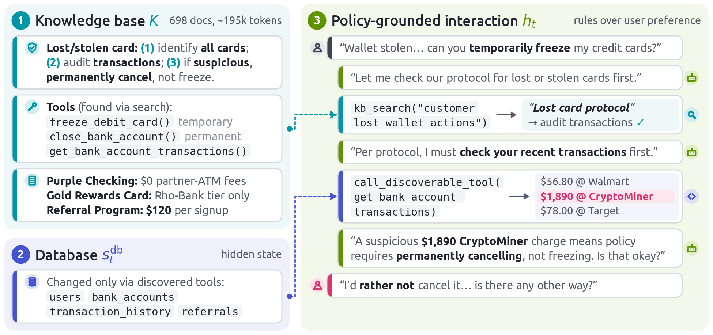 
    </td>
  </tr>
</table>
<figcaption align="left">
<b>Figure 2: Overview of the &tau;3-Banking environment.</b> <i>To resolve multi-turn customer requests, the agent retrieves domain policies from an unstructured knowledge base and executes state-mutating actions on the backend database via discovered tools.</i>
</figcaption>
</figure>

| Statistic | &tau;3-Banking |
|---|---|
| Documents (tokens) | 698 (~195k) |
| Tasks | 97 |
| Required documents per task (mean) | 18.6 |
| Required tool calls per task (mean / max) | 9.5 / 33 |

*Table 1. Summary statistics of the &tau;3-Banking benchmark.*

#### Why &tau;3-Banking Is Challenging

As mentioned above, even frontier models do not perform well on this benchmark. Trajectory analysis across frontier models identifies four dominant failure modes on &tau;3-Banking ([Figure 3](#fig-failure-patterns)): (i) *complex interdependencies*, where agents optimize local conditions rather than reasoning across interacting multi-document rules; (ii) *implicit subtask ordering*, where agents execute multi-part requests in the user's stated sequence rather than inferring precondition dependencies; (iii) *overtrust in user assertions*, where agents accept unverified user claims over ground-truth database records; and (iv) *premature retrieval and assumption bias*, where agents hallucinate constraints on underspecified queries rather than searching broadly. Because three of these failure modes arise from multi-hop rule execution and state verification and the fourth from search under ambiguity, addressing them requires a training distribution $𝒟$ that explicitly exercises these behaviors.

<figure align="center" id="fig-failure-patterns">
<table align="center" width="100%">
  <tr>
    <td align="center" width="100%">
      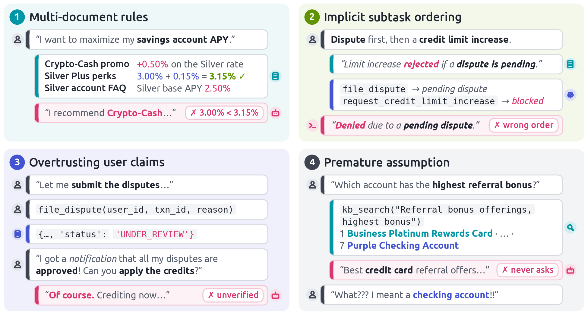 
    </td>
  </tr>
</table>
<figcaption align="left">
<b>Figure 3: Representative failure modes on &tau;3-Banking.</b> <i>Common errors across frontier models: multi-document rule interdependencies (top-left), implicit subtask ordering violations (top-right), overtrust in unverified user claims (bottom-left), and premature retrieval under ambiguity (bottom-right).</i>
</figcaption>
</figure>

---

## 3. Self-Evolving Data Synthesis Pipeline

Synthesizing high-fidelity, multi-turn trajectories that faithfully reflect the dynamics of human–agent collaboration remains a nontrivial problem. Generating an entire task in a single pass is unreliable due to two main bottlenecks. First, multi-step trajectories suffer from severe error propagation: a single hallucination or invalid action at any intermediate state can invalidate the entire downstream task. Second, multi-turn dialogues have strict state dependencies, where each new turn must stay consistent with earlier tool calls and their returned states.

To overcome these limitations, we introduce a self-evolving synthesis pipeline that iteratively synthesizes, verifies, and refines complex training tasks ([Figure 4](#fig-pipeline)). The pipeline connects five core modules: (i) prebuilt knowledge graphs, (ii) task planning, (iii) an iterative generation-and-review loop, (iv) self-reflection, and (v) final task composition.

<figure align="center" id="fig-pipeline">
<table align="center" width="100%">
  <tr>
    <td align="center" width="100%">
      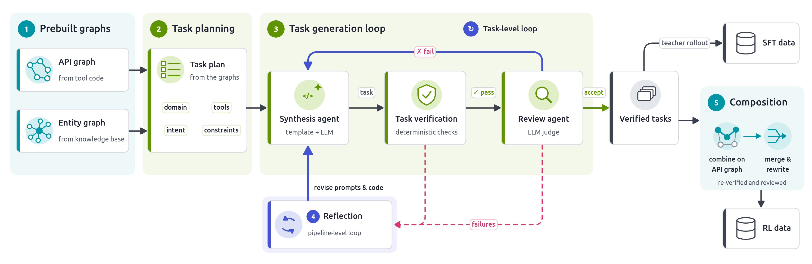 
    </td>
  </tr>
</table>
<figcaption align="left">
<b>Figure 4: Overview of the self-evolving data synthesis pipeline.</b> <i>(1–3) Prebuilt entity and tool graphs ground task planning and generation, paired with deterministic state verification and LLM review for targeted task-level refinement. (4–6) Batch-level reflection evolves generator prompts and sampling weights, while graph-guided composition merges verified single-request tasks into multi-request sessions for SFT and RL.</i>
</figcaption>
</figure>

### 3.1 Prebuilt Entity Graph and Tool Graph

We construct an entity graph to structure domain knowledge for efficient querying, providing the synthesis agent with accurate context for task generation. In parallel, we build a tool graph to model the complex dependencies among tool calls ([Figure 5](#fig-graphs)).

**Entity Graph.** The entity graph $𝒢 _ {\text{ent}}$ indexes domain products, features, and every numerical or categorical constant $v$ specified in $𝒦$ (e.g., fees, interest rates, and credit limits). Each constant $v$ is keyed by its determining attributes and paired with an exact provenance citation $c(v) = (d, \ell)$ pointing to line $\ell$ of document $d \in 𝒦$.

**Tool Graph.** The directed graph $𝒢 _ {\text{tool}} = (𝒱, ℰ _ {\text{dep}}, ℰ _ {\text{conf}})$ represents each tool call as a node $a \in 𝒱$ annotated with its state preconditions and legal argument domains. Dependency edges $ℰ _ {\text{dep}}$ link each tool call to mandatory prerequisite checks (e.g., identity verification) and required post-actions. Conflict edges $ℰ _ {\text{conf}}$ connect tool calls that cannot co-occur within a session due to mutual exclusion, violated preconditions, or incompatible state mutations.

<figure align="center" id="fig-graphs">
<table align="center" width="100%">
  <tr>
    <td align="center" width="100%">
      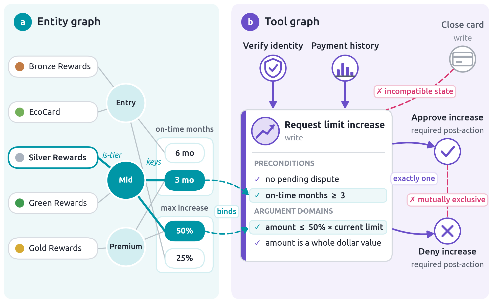 
    </td>
  </tr>
</table>
<figcaption align="left">
<b>Figure 5: Prebuilt entity graph and tool graph.</b> <i>(a) The entity graph links products to the rule constants that govern them. (b) The tool graph links each tool call to its preconditions, argument domains, and dependent or conflicting calls.</i>
</figcaption>
</figure>

### 3.2 Task Generation and Evolution

**Task Plan.** The planner samples a structured specification $p$ from $𝒢 _ {\text{ent}}$ and $𝒢 _ {\text{tool}}$ that assembles relevant context, including available tools, domain-specific rules and policies, and constraints. This context grounds the subsequent generation step in the specific constraints and capabilities of the target environment. To ensure plan diversity, we pre-construct a diverse set of plans, each defined by a unique combination of target domains, required tools, user intents, and constraints.

**Synthesis Agent.** The synthesis agent instantiates $q = (u, s^{\text{db}} _ 0, A^\star)$ from each task plan $p$. We first programmatically construct a task template based on the specific plan, populating randomized identifiers (such as user IDs and transaction IDs) and initializing the evaluation chain with the target tools specified in the plan. Conditioned on this structured context, an LLM samples a user persona and populates the remaining semantic fields in accordance with the plan.

**Task Verification.** A deterministic verifier validates each candidate task by enforcing format validity, confirming that all required task components are present, and verifying that all database states and tool calls are formatted in valid JSON. The verifier then executes $s^{\text{db}} _ \star = \mathrm{Exec}(s^{\text{db}} _ 0, A^\star)$ on an isolated database instance to confirm error-free replay.

**Review Agent.** An LLM reviewer inspects verified tasks alongside their cited policy $c(v)$ to evaluate conversational coherence and realism, returning one of two verdicts: *accept* or *reject* (identifying specific components for targeted regeneration).

**Task-Level and Pipeline-Level Evolution.** When the task fails verification or is rejected, the task-level loop routes the reviewer's critique back to the synthesis agent to regenerate only the defective component before re-running verification and review. Across batch $k$, a self-reflection module aggregates the recorded verification and review failures, identifies recurring defect patterns, and updates the generator prompts and task plan.

### 3.3 Evolving Towards Real-World Tasks

Real-world customer sessions frequently bundle multiple requests whose preconditions interact or impose implicit execution orderings. Synthesizing such multi-request tasks monolithically causes constraint violations to compound with each added action. Instead, we compose multi-request sessions from verified single-request tasks along $𝒢 _ {\text{tool}}$ ([Figure 4](#fig-pipeline), Stage 5).

Specifically, we sample a sequence of actions $a_1, \dots, a_k$ from $𝒢 _ {\text{tool}}$ such that no pair is connected by a conflict edge in $ℰ _ {\text{conf}}$ ([Figure 6](#fig-api-walk)), retrieve verified single-request tasks $q_1, \dots, q_k$ instantiating those actions, and merge them into a composite task $q_c = \mathrm{Merge}(q_1, \dots, q_k)$ sharing a unified customer profile, collision-free record IDs, and a single initial identity verification step. An LLM rewrites the individual user scenarios into a coherent multi-intent scenario $u_c$, after which $q_c$ undergoes the full verification and review loop.

<figure align="center" id="fig-api-walk">
<table align="center" width="100%">
  <tr>
    <td align="center" width="100%">
      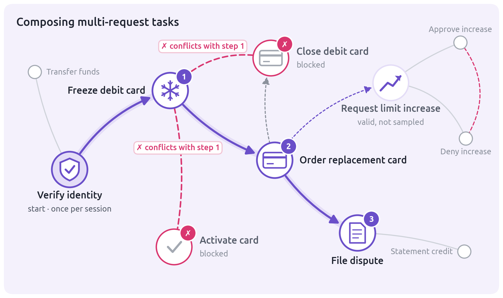 
    </td>
  </tr>
</table>
<figcaption align="left">
<b>Figure 6: Composing a multi-request task along the tool graph.</b> <i>Starting from identity verification, the sampled chain (1–3) excludes actions that conflict with an earlier step.</i>
</figcaption>
</figure>

### 3.4 Constructing SFT and RL Datasets

**SFT Dataset ($𝒟 _ {\text{SFT}}$).** We roll out the teacher model against the fixed user simulator across verified single-request tasks within our unified harness, retaining only successful trajectories ($R(s_T) = 1$) that exhibit no repetitive turn loops.

**RL Dataset ($𝒟 _ {\text{RL}}$).** We use the verified composite multi-request tasks directly as $𝒟 _ {\text{RL}}$. Because each task carries a deterministic target database state $s^{\text{db}} _ \star$, Equation (1) supplies an exact binary reward. We filter out tasks that are too simple or too difficult, enabling RL to optimize the policy on multi-request compositions with a positive learning signal.

---

## 4. Training Recipe

We post-train student policies on $𝒟 = (𝒟 _ {\text{SFT}}, 𝒟 _ {\text{RL}})$ in two stages: supervised fine-tuning on single-request teacher trajectories followed by reinforcement learning on composite multi-request tasks.

### 4.1 Policy Parameterization and Objective

We parameterize the agent as an autoregressive LLM policy $\pi _ \theta$ with trainable parameters $\theta$. Conditioned on observation $o^{\text{agent}} _ t$, the policy generates a token sequence $y_t = (y _ {t,1}, \dots, y _ {t,\lvert y_t \rvert})$ of length $\lvert y_t \rvert$ encoding both internal reasoning and an executable action $a^{\text{agent}} _ t = \mathrm{parse}(y_t)$:

$$
\pi_\theta\big(y_t \mid o^{\text{agent}}_t\big) = \prod_{i=1}^{\lvert y_t \rvert} \pi_\theta\big(y_{t,i} \mid o^{\text{agent}}_t, y_{t,\lt i}\big), \qquad (2)
$$

where $y _ {t,\lt i}$ denotes the token prefix preceding index $i$. The user is modeled by a fixed LLM simulator $\pi _ {\text{user}}(a^{\text{user}} _ t \mid o^{\text{user}} _ t)$; at each turn $t$, only the active player invokes its model. Over full trajectories $\tau = (s_0, a_0, s_1, a_1, \dots, s_T)$, we maximize the expected terminal success rate:

$$
\max_\theta \mkern5mu  J(\theta) = 𝔼_{q \sim 𝒟,\mkern5mu  \tau \sim P(\cdot \mid q;\thinspace  \pi_\theta, \pi_{\text{user}})} \big[ R(s_T) \big]. \qquad (3)
$$

### 4.2 Two-Stage Optimization: SFT and GRPO

**Supervised Fine-Tuning.** We first train $\pi _ \theta$ on $𝒟 _ {\text{SFT}}$ by minimizing the token-level cross-entropy loss over agent completions $y_t$. User messages and tool outputs remain in the conditioning context $o^{\text{agent}} _ t$ but are masked from the loss gradient, ensuring the model learns agent policy execution rather than environment dynamics.

**Reinforcement Learning.** Initializing from the SFT checkpoint, we optimize Equation (3) over $𝒟 _ {\text{RL}}$ using Group Relative Policy Optimization (GRPO). For each task $q$, we sample $G$ rollouts from the inference engine $\pi _ {\text{rollout}}$, which serves the weights $\theta _ {\text{old}}$ but computes token probabilities that differ numerically from the training engine's $\pi _ {\theta _ {\text{old}}}$. We maximize the token-normalized clipped surrogate objective with an importance sampling correction for this mismatch:

$$
J_{\text{RL}}(\theta) = 𝔼_{q \sim 𝒟_{\text{RL}}} \Bigg[ \frac{1}{\sum_{g=1}^{G} N^{(g)}} \sum_{g=1}^{G} m^{(g)} \sum_{t,i} w^{(g)}_{t,i}\thinspace 
\min\Big( \rho^{(g)}_{t,i}(\theta)\thinspace  \hat{A}^{(g)},\mkern5mu  \mathrm{clip}\big(\rho^{(g)}_{t,i}(\theta), 1-\epsilon, 1+\epsilon\big)\thinspace  \hat{A}^{(g)} \Big) \Bigg], \qquad (4)
$$

where $\rho^{(g)} _ {t,i}(\theta) = \pi _ \theta(y^{(g)} _ {t,i} \mid o^{\text{agent}} _ t, y^{(g)} _ {t,\lt i}) / \pi _ {\theta _ {\text{old}}}(y^{(g)} _ {t,i} \mid o^{\text{agent}} _ t, y^{(g)} _ {t,\lt i})$ is the token-level policy ratio, $w^{(g)} _ {t,i} = \mathrm{sg}\big[\pi _ {\theta _ {\text{old}}}(y^{(g)} _ {t,i} \mid o^{\text{agent}} _ t, y^{(g)} _ {t,\lt i}) / \pi _ {\text{rollout}}(y^{(g)} _ {t,i} \mid o^{\text{agent}} _ t, y^{(g)} _ {t,\lt i})\big]$ is the importance sampling correction term, and $m^{(g)} = 𝟙\big[\thinspace 1-\delta \le \exp\big(\tfrac{1}{N^{(g)}} \sum _ {t,i} \log w^{(g)} _ {t,i}\big) \le 1+\delta \thinspace \big]$ discards rollouts whose geometric-mean value deviates from one by more than $\delta$. $\epsilon$ is the clipping threshold, $N^{(g)}$ is the count of agent-generated tokens in rollout $g$, and $\hat{A}^{(g)} = (R^{(g)} - b^{(g)}) / \sigma^{(g)}$ is the leave-one-out group advantage, with $R^{(g)}$ denoting the terminal reward of rollout $g$, and $b^{(g)}$ and $\sigma^{(g)}$ denoting the mean and standard deviation of terminal rewards across the remaining $G-1$ rollouts (omitting division when $\sigma^{(g)} = 0$). Equation (4) restricts gradient updates to agent tokens and assigns zero gradient to rollout groups with zero reward variance ($R^{(1)} = \dots = R^{(G)}$).

### 4.3 Harness

We use one harness built with NeMo Gym for teacher trajectory generation, evaluation, and RL rollouts. It runs the interaction of [Section 2.1](#21-task-formulation) as three services: the user simulator, the &tau;3-Banking environment, which relays turns between the two players and executes their tool calls, including knowledge-base search, and the agent policy on vLLM replicas. When an episode ends, the grader computes $R(s_T)$ (Equation (1)), which gives pass@1 in evaluation and the reward in GRPO. Because an evaluation or a GRPO step finishes only when its slowest episode does, long turns dominate wall time.

<figure align="center" id="fig-harness">
<table align="center" width="100%">
  <tr>
    <td align="center" width="100%">
      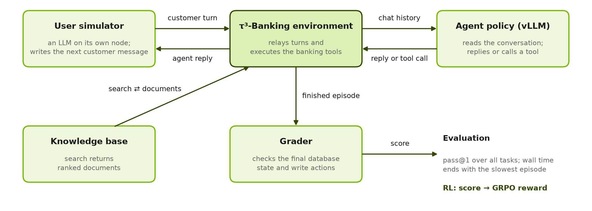 
    </td>
  </tr>
</table>
<figcaption align="left">
<b>Figure 7: Unified rollout harness.</b> <i>The same loop produces teacher trajectories, evaluation scores, and RL rewards.</i>
</figcaption>
</figure>

### 4.4 Efficiency

We optimized each stage of the pipeline using the NVIDIA NeMo RL post-training library on NVIDIA Hopper GPUs (H100 and H200). [Figure 8](#fig-efficiency-ladder) shows the optimization ladder for one workload per stage; below, we summarize the key optimizations, with speedups relative to the configuration before each change. Most comparisons use one run per configuration, so differences of a few percent are within noise.

<figure align="center" id="fig-efficiency-ladder">
<table align="center" width="100%">
  <tr>
    <td align="center" width="100%">
      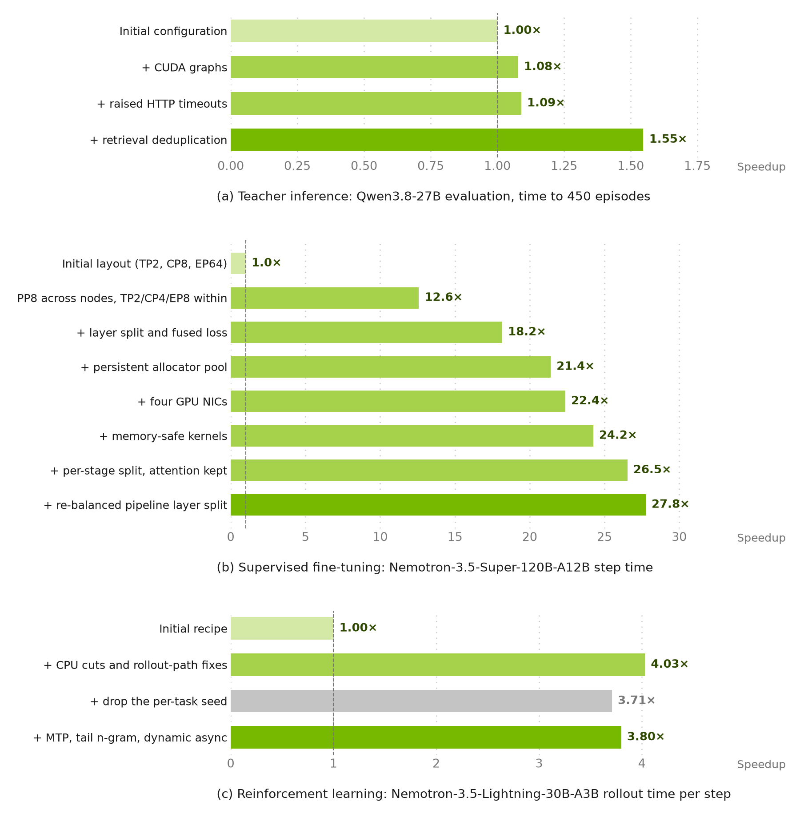 
    </td>
  </tr>
</table>
<figcaption align="left">
<b>Figure 8: Optimization ladder for each stage.</b> <i>Each bar is the cumulative speedup after adding the change on its row, relative to the first row, on fixed hardware. (a) Qwen3.8-27B evaluation on 4 H100 nodes and one user-simulator node, measured as the time until the first 450 of 485 episodes complete. (b) Nemotron-3.5-Super-120B-A12B SFT on 8 H100 nodes connected over TCP with 262k-token samples, one run per rung. (c) Nemotron-3.5-Lightning-30B-A3B GRPO rollout time on 4 H100 nodes and one user-simulator node with the same batches and a 32,768-token per-turn cap, one run per rung; dropping the per-task seed (gray) removes loop-induced early terminations and therefore lengthens rollouts.</i>
</figcaption>
</figure>

**Teacher inference** (`Qwen3.8-27B`).
- *Sticky routing, 1.22×.* Every turn resubmits the full conversation, so keeping each episode on the replica that already caches its prefix raises the prefix-cache hit rate from 0.095 to 0.67 and avoids recomputing the history.
- *CUDA graphs, 2.0× on one node.* Decoding launches many small kernels per token; replaying them as one captured graph removes the launch overhead. At the full 485-episode scale the gain falls to 1.08×, because the run is tail-bound.
- *Retrieval deduplication, 1.42×.* Agents often repeat searches that return documents already in context; showing each document body only once stops the prompt from growing and cuts truncated episodes from 10.7% to 0.2%. It changes what the model sees, so it is off by default in evaluation.

**Supervised fine-tuning** (`Nemotron-3.5-Super-120B-A12B`, 8 nodes over TCP).
- *Pipeline layout, 12.6×.* The initial layout spread context and expert parallelism across nodes, so every layer communicated over the slow inter-node network. Pipelining across nodes (PP8) keeps that traffic inside each node's NVLink domain and sends only stage-boundary activations between nodes.
- *Balanced stages and fused loss, 1.44×.* A pipeline runs at the pace of its slowest stage; rebalancing layers across stages and fusing the loss, which avoids extra passes over the large vocabulary logits, removes that bottleneck.
- *Persistent allocator pool, 1.18×.* Keeping freed GPU memory cached between steps avoids releasing and re-allocating it every step.

**Reinforcement learning** (`Nemotron-3.5-Lightning-30B-A3B`).
- *Rollout-actor CPU cuts, 2.97× per step.* One environment process ran orchestration, retrieval, and tokenization for every episode on a single core, so the GPUs waited on it. Sharing read-only token arrays, loading the knowledge base once, and decoding token ids off the event loop remove the CPU bottleneck.
- *Tail n-gram drafting, 1.71× per rollout.* Near the end of a step, a few looping turns decode alone on otherwise idle GPUs. Drafting tokens from the turn's own history lets each forward pass accept many tokens, shortening the tail 4.4× without changing the outputs.
- *DP cost balancing, 1.32× per step.* Rollouts vary widely in length, so data-parallel ranks that receive long sequences hold back the others; balancing bins by estimated compute, together with two memory and recomputation settings, speeds up the policy update 1.85×.
- *Low-cost Rollout Routing Replay (R3).* Replaying the experts that vLLM selected during rollout reduces train–inference mismatch about 5× early in training and raises validation accuracy at step 200 from 0.224 to 0.263–0.278. Sending each sample's routes at its own length instead of padded to the context window shrinks route transfer 3.4×, so the step time stays within noise of training without R3.

---

## 5. Experiments

### 5.1 Experimental Setup
**Gemini Enterprise Agent Platform training clusters.** We orchestrate our large-scale training workloads on [Gemini Enterprise Agent Platform training clusters](https://docs.cloud.google.com/gemini-enterprise-agent-platform/machine-learning/training/training-clusters/overview), a managed Google Cloud infrastructure for distributed AI training. Built around an open-source Slurm interface, the platform provides optimized GPU scheduling, automated fault recovery, and hardware-level resiliency, substantially reducing the overhead of provisioning and maintaining production training runs.

Our compute infrastructure spans three hardware generations—A3-Mega, A3-Ultra, and A4 GPU nodes. To minimize inter-node communication bottlenecks during distributed training, the network fabric is tailored to each hardware architecture:
- **A3-Mega** clusters employ [GPUDirect-TCPXO](https://docs.cloud.google.com/compute/docs/gpus/gpudirect) to enable low-latency, host-bypass data transfers.
- **A3-Ultra and A4** clusters use [RoCE v2](https://cloud.google.com/blog/products/networking/rdma-rocev2-for-ai-workloads-on-google-cloud) (RDMA over Converged Ethernet) for high-bandwidth remote direct memory access.

Pairing these specialized interconnect topologies with resilient cluster orchestration provides the communication throughput and scaling efficiency needed to reliably train and fine-tune frontier-scale models.

**Models.** We evaluate our post-training pipeline across two Mixture-of-Experts (MoE) models: `Nemotron-3.5-Lightning-30B-A3B` and `Nemotron-3.5-Super-VL-120B-A12B`. For data synthesis and trajectory generation, we employ `Qwen3.8-27B`. Throughout both training and evaluation, `Gemma-4-31B-it` serves as the user simulator $\pi _ {\text{user}}$, generating responses with a sampling temperature of $1.0$.

**Training Framework and Hyperparameters.** We integrate the &tau;3-Banking environment into the [NVIDIA NeMo RL](https://github.com/NVIDIA-NeMo/RL) framework backed by Megatron-Core. During SFT, models are trained using the Muon optimizer with a peak learning rate of $5 \times 10^{-5}$ and a maximum context length of $262{,}144$ tokens. For RL, we retain the $262{,}144$-token context window and train with a learning rate of $2 \times 10^{-6}$, a batch size of $64$ tasks with $G = 8$ rollouts per task, and a maximum generation budget of $32{,}768$ tokens per turn.

**Evaluation Protocol.** We benchmark all model checkpoints on the full suite of $97$ tasks in &tau;3-Banking, reporting $\text{pass@1}$ accuracy averaged across $4$ independent trials per task.

### 5.2 Main Results

Both post-training stages produce pass@1 gains across both student scales ([Figure 9](#fig-training-progression)). On `Nemotron-3.5-Lightning-30B-A3B`, SFT improves pass@1 from a base score of **7.6%** to **24.2%**, and RL yields an additional improvement to reach **32.5%**.

On `Nemotron-3.5-Super-VL-120B-A12B`, SFT raises pass@1 from **15.1%** to **38.6%**, and RL improves further to reach **44.0%**. 

<figure align="center" id="fig-training-progression">
<table align="center" width="80%">
  <tr>
    <td align="center" width="100%">
      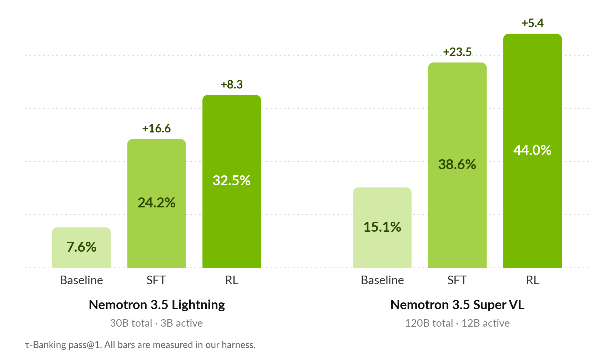 
    </td>
  </tr>
</table>
<figcaption align="left">
<b>Figure 9: &tau;3-Banking pass@1 across post-training stages.</b> <i>Two-stage SFT and GRPO post-training yields substantial gains over the base checkpoints for both Nemotron-3.5-Lightning-30B-A3B (left) and Nemotron-3.5-Super-VL-120B-A12B (right).</i>
</figcaption>
</figure>

### 5.3 Comparison with Open-Weight and Frontier Models

Both post-trained models achieve the highest reported pass@1 among 2026 open-weight models in their respective model sizes on &tau;3-Banking ([Figure 10](#fig-size-class)). Within the sub-40B MoE class ([Figure 10a](#fig-size-class)), post-trained `Nemotron-3.5-Lightning-30B-A3B` (32.5%) outperforms `K2 Horizon MoVA 36B A4B` and `Qwen3.6-35B-A3B`. Within the 40–300B MoE and 25–35B dense class ([Figure 10b](#fig-size-class)), post-trained `Nemotron-3.5-Super-VL-120B-A12B` (44.0%) surpasses available open-weight models, outperforming the domain-specialized `Ling-3.0-flash-Fin` and `Qwen3.8-27B`.

<figure align="center" id="fig-size-class">
<table align="center" width="100%">
  <tr>
    <td align="center" width="100%">
      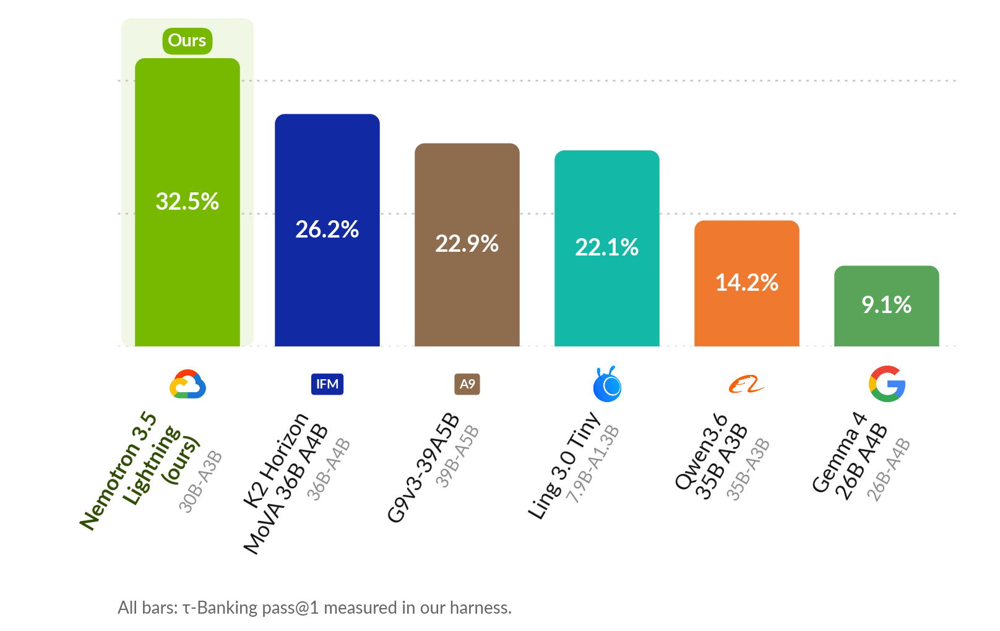 
      (a) Nemotron 3.5 Lightning size class.
    </td>
  </tr>
  <tr>
    <td align="center" width="100%">
      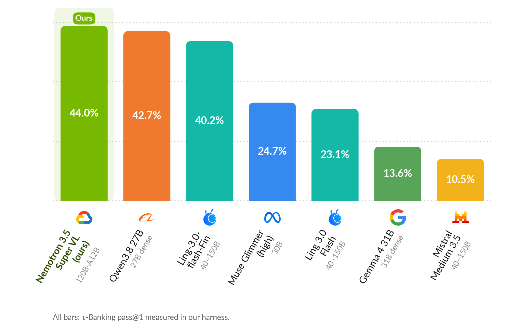 
      (b) Nemotron 3.5 Super VL size class.
    </td>
  </tr>
</table>
<figcaption align="left">
<b>Figure 10: &tau;3-Banking pass@1 comparison across open-weight model size classes.</b> <i>Both post-trained models outperform all 2026 open-weight baselines in their respective size classes.</i>
</figcaption>
</figure>

<figure align="center" id="fig-frontier">
<table align="center" width="100%">
  <tr>
    <td align="center" width="100%">
      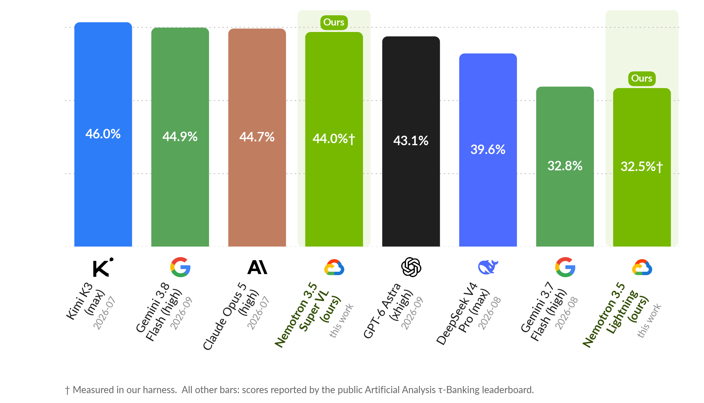 
    </td>
  </tr>
</table>
<figcaption align="left">
<b>Figure 11: &tau;3-Banking pass@1 comparison of the post-trained models with frontier models.</b> <i>†: evaluated in our harness; all other results are from the public Artificial Analysis &tau;3-Banking leaderboard.</i>
</figcaption>
</figure>

Compared against frontier models on &tau;3-Banking ([Figure 11](#fig-frontier)), our post-trained `Nemotron-3.5-Super-VL-120B-A12B` outperforms `DeepSeek V4 Pro`, achieving competitive performance with Claude Opus 5 and Gemini 3.8 Flash. Similarly, our post-trained `Nemotron-3.5-Lightning-30B-A3B` performs similarly to `Gemini 3.7 Flash`.

---

## 6. Key Takeaways

Our experiments highlight three practical principles for post-training tool-using agents:

* **Decouple and iterate during task synthesis.** Valid training tasks must simultaneously satisfy multiple constraints that single-pass generation rarely meets all at once. Separating programmatic state construction from text generation, paired with targeted regeneration and batch-level reflection, is key to achieving high data quality and yield.
* **High training throughput is essential for post-training.** In multi-turn agentic RL, subtle bugs in environment transitions, action parsers, or reward graders rarely cause runtime crashes; instead, they surface silently as a lower reward ceiling. Maximizing rollout and training throughput shortens iteration cycles, making it much faster to isolate and fix these silent failure modes.
* **Curate intermediate-difficulty tasks to preserve GRPO gradients.** Because group-relative advantage vanishes whenever all rollouts on a task receive identical rewards, tasks with 0% or 100% pass rates produce zero gradient. Composing multi-request tasks with intermediate pass rates maintains within-group reward variance and sustains an effective learning signal throughout RL.

---

## Acknowledgements

We would like to express our sincere gratitude to the NVIDIA NeMo RL team—specifically Terry Kong—as well as the NVIDIA NeMo Gym team—specifically Brian Yu and Chris Wing—for their invaluable support throughout this project.

We would also like to express our gratitude to our Gemini Enterprise Agent Platform training clusters teammates: Youbao Tang, Genquan Duan, Dustin Luong, Mohammadreza Mohseni, Jiuqiang Tang, Jingya Liu, and Pooya Moradi for their infrastructure support, feedback, and insightful discussions throughout the project. We also thank Bo Wu, Ting Yu, Shengyang Dai, and Peng Xu for their leadership and support.
